2026 October Retrospective
=========================

Another month, another *retrospective* packed totally choke-full of random tat, blurbs and other assorted goodies. I quite honestly feel like I am *manifesting* the *newsletter format* more and more with every passing month.

Luckily, I can blame it all on *Mercury* currently being in *retrograde*. That surely will make all of it *A-okay*, correct? And besides, I've been going through the *mandatory sensibility training* required for starting my very own *Substack*.

Too soon? Alright, I'll see myself right out. I know the way, don't get up please.

## The Exorcist: Martyrs


Look, I'd be more than happy to watch paint dry all day long if I had to, so long I knew that [Scarlett Johansson][sjo] was involved somehow in the process that is; but, be that as it may, I am not entirely convinced the *actual potency* of this new entry in the [Exorcist franchise][exorcist] just yet.



Sure, it's [Flanagan][flanagan] at the helms, who happens to have both the pedigree and the back-catalog to show for it, yet there's still some ever so slight trepidation in the air, that makes me just a tiny bit skeptical about it. That is all.

## Typora 2.0: A New Chapter

I impulse bought [Typora][typora] on `March 23, 2022`, not too long after downloading the `15 day` trial version of it.

There are of course a number of annoyances that became more apparent over the years, but overall it has successfully kept me from *rolling my very own markdown editor*.

Now that [Typora 2][typora2] has been announced, I feel like its *charms* might just end up delaying the inevitable just a little while longer, especially if *tabs* become a reality.

## Halls of Torment: The Lost Archives

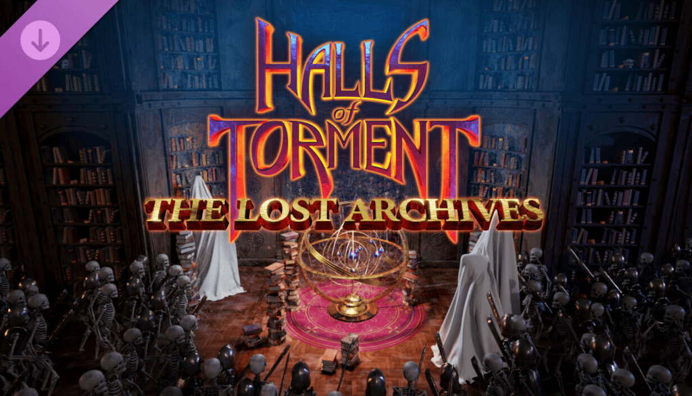

I said this before, and I have no problem with saying it again. [Halls of Torment][hallsoftorment] is the one of the best [Vampire Survivors][vampiresurvivors] *clones* out there, bar none.



Just as an *FYI* for any interested parties, it's worth calling out that [The Lost Archives][hallsoftormentthelostarchives] has also been locked behind some good old fashioned *grind-fest*, which manifests itself in the form of having at least `5` *marks* unlocked.

It's not as annoying as with [The Boglands][hallsoftormenttheboglands], but still unpleasant. I totally get it why it was done this way, but please do not ever do this, especially when we are talking about content that has been *paid* for in full.

Obviously, don't let this minor gripe of mine dissuade you from grabbing the DLC for yourself. It's a wee bit unbalanced as per usual, but overall, it's still jolly good fun.

Monkey-brain *likes*, monkey-brain *approves*, and the cycle continues.

## Usenet-Rewind

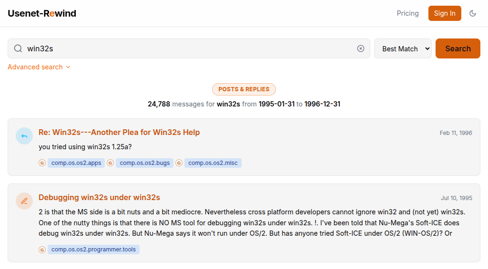

These [usenet][usenet] archives seem to be popping up like mushrooms after a cold radioactive summer rain in Chernobyl.

Many of them are usually simply snapshots of various time periods, all this while [Usenet-Rewind][usenetrewind] on the other hand, appears to have *everything* ranging from `1981` to the present day.

## Macworld Magazine Archive


Even this rather comprehensive [archive][macworldarchive] of the [Macworld magazine][macworld] seems to hit completely different.

Oh, these *pesky macintosh-ians* and their rather refined sense of taste ...

## Underkeep

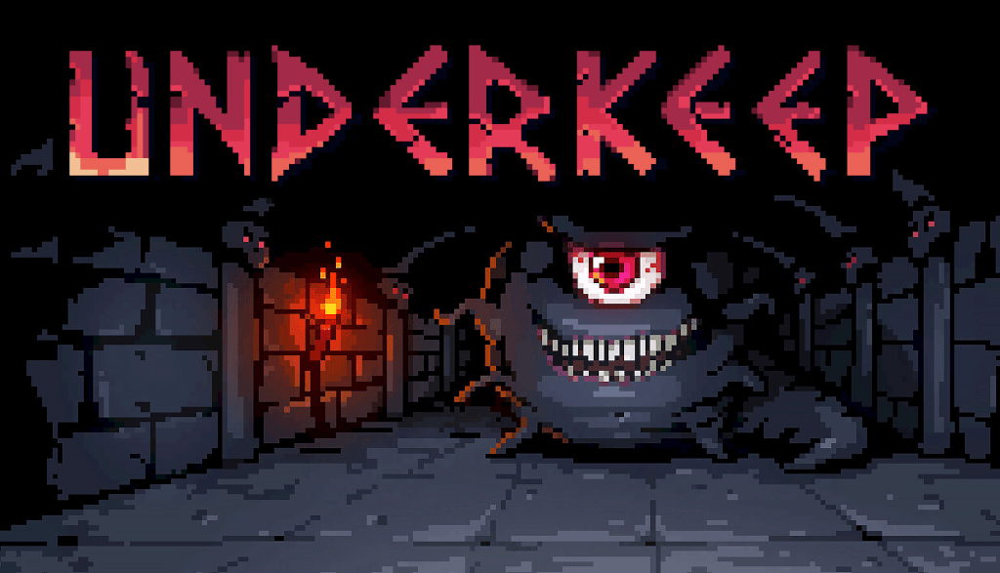

I have been keeping an eye on [Underkeep][underkeep] for quite some time, as it kept showing up on my feeds.



Unfortunately, after spending some time with the *demo version*, I must confess that I haven't enjoyed it as much as I thought that I would.

The art direction is absolutely gorgeous of course, but I feel like there's just too much clutter, and it all feels a bit too claustrophobic to me.

Will still end up picking it up when it finally launches early in `November`, though.

## Ahoy: Singularity



[Singularity][singularity] is an FPS that I don't ever remember seeing anywhere, nor do I remember hearing anybody talking about it like at all. Which is all very weird to say the least.

## DOS Inside: Online Party

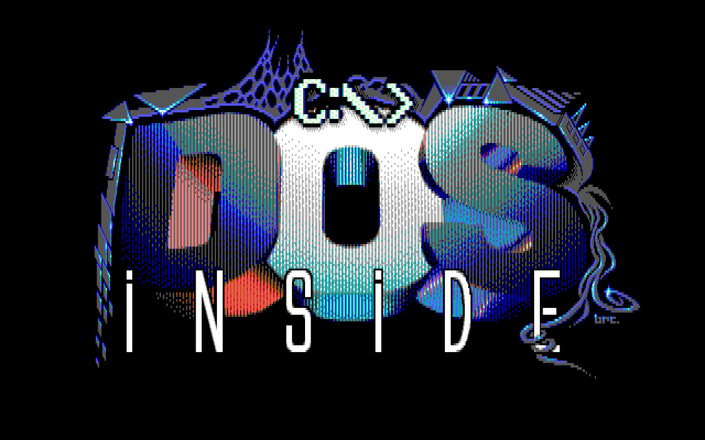

[DOS Inside][dosinside] is an upcoming online party exclusively for DOS demos, that is scheduled to happen and go down between the `27th` to the `28th` of `November`.



It's rather heart-warming to see that good old [DOS][dos] is still getting some very well deserved love, especially during these rather difficult times in the `21st` century.

Oh, and before I forget, here's a [link][dosinsideintro] to the *invtro* above.

## How many dudes?


Speaking of *shenanigans*, how about some rather special *butterscotch* flavored ones? No? Alright, to each his own and all that good stuff. It is not my intention in the slightest to end up *yucking* your *yum* you know?

This [major 1.1 update][howmanydudesnewdudes] most definitely sets the bar quite high for others to follow, when it comes to keeping the momentum going with a game in the *auto-battler genre* that is for sure.

Did I mention the *sport dudes*?


Take a look at this awesome bunch, and tell me with a straight face that you don't love them already?

## You Can See Everything


I am sure that you've been hearing a tad too much about the [You Can See Everything][youcanseeeverything] documentary by [Nathan Fielder][nfielder], to the point where you might have developed a tiny bit of fatigue, but I just had to mention it in some form or another. Sorry, not sorry!





If for some peculiar reason or another you might want to temporarily step into the shoes of [Elizabeth Holmes][eholmes] herself, then be sure to check  out this pure work of art over at [theranos.world][theranos.world]. You'll thank me in the morning. *Wink, wink*.

## Spikklubba


I don't even know where to start with [Spikklubba][spikklubba] to be totally and perfectly honest. It really checks all the boxes when it comes graphics, but it entirely misses the mark when it comes to the *gameplay* itself.



A game like this with a proper *over-world* or a traditional *Diablo-style town*, and proper *dungeons* that can be explored without any silly timers, and other limitations, would be absolutely amazing.

I wouldn't even mind the turn-based nature of it, and you all know me well enough by now to know that I have a very nasty allergy for anything turned-based

Some people will of course take issue with the fact that it has been *vibe coded*, and it's full of subtle bugs as a direct result, but those are just details that don't really concern me in the slightest.

There was and still is plenty of *slop* being churned out by using *Unity* and other *engines* that focused a bit too much on the *democratization* part, and way too little on the actual technology itself.

## Microlayoff: 60K

Can you even imagine to contemplate being one of the *chosen* [60K][ms60k] employees at *Microslop*, who have probably logged in like every other morning, and then subsequently noticed the *buyout offer* e-mail sitting in their *inbox*?

*60 fraking K*. That is almost twice the population of the town that I've grew up in. It's absolutely mental.

Every single time I see mass-layoffs at this scale, I always wonder to myself, what in the name of *John F. Kennedy* were they all doing each and every day at *Microslop*?

And more importantly, why were they hired to begin with? What kind of a project or projects have necessitated this many people to be on the payroll?

I do realize that this is across the company and it's not targeting a singular business unit or team, but that doesn't really change the nature of my previous questions.

Now imagine something else. All those people will be on the lookout for a new job soon enough. The market is already the worst it has been. Even in the *annus terribilis*, that was `2008`, things weren't anywhere near this bad, and that should tell you something.

Perhaps there's something to the *urban-legend* claiming that there's a financial crisis of some kind roughly every `10` years or so after all.

I mean, you can only reduce the standard of living of so many people, before the pendulum swings back and you find yourself with your neck under the guillotine, whether you had something to do with it or not.

## Ali G: Who Iz I?

I was very surprised that this has gotten the *green light* at all. But, I also knew that there's no way in hell that it will be able to pull anywhere near the same numbers as its predecessor.



The year is simply no longer `2002`, just in case it wasn't obvious. *Booyakasha*.

## Homegrown Cacao

As someone who has been trying to grow a couple of lemon trees from nothing but seeds, I feel like I can truly appreciate attempts such as [this][homegrowncacao] to grow *Cacao trees* indoors.

What a journey, and what an experience. Truly amazing. There's just something almost magical about it.

## ERLIK


Another one? Yes, indeed. You better get used to it, as there will no doubt be many more to come.



Anyway, I tried out the demo version of [ERLIK][erlik], and I can say that overall I would consider it to be a solid contender in this already extremely crowded genre.

Thematically it is super fresh, but visually I must say that it does feel a tiny bit bland in places. The environments, characters, creatures, and bosses are of course super interesting, which is something to be expected given the nature of the theme itself. I mean one simply can't go wrong with Turkic mythology.

The music on the other hand is excellent in every respect as far as I am concerned, if you fancy the Turkic style that is. I hope that the soundtrack will also be available to purchase straight away once it finally launches in *early access* in the first part of `November`.

It's also worth calling out the fact that this is a `Godot` game by the way.

## Cryo Chamber: Aetherium Nebula - Ephemeral Port

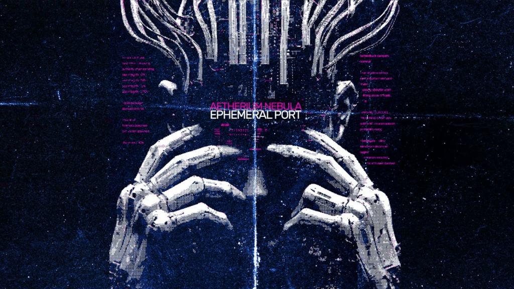



## Diablo 2: Survivors

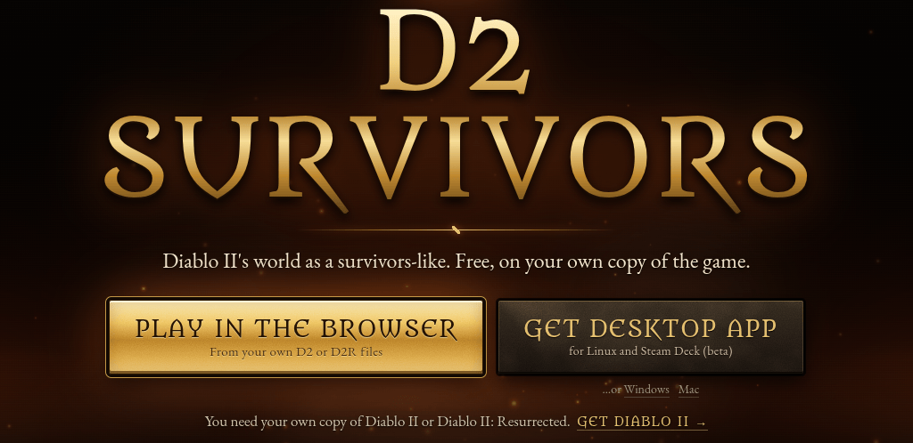

What is there left to say, that wasn't already said about [Diablo 2: Survivors][d2survivors]?



I am surprised that it wasn't immediately taken down by [Blizzard][blizzard], considering that even though it claims that one must *own a legitimate copy* the game, it still lets one play without *providing* said copy.

When I first saw this, I thought that it surely must be relying *only* on the assets from the original *shareware version*, which would have put it straight into that *gray legal area* so to speak.

But no, that doesn't seem to be the case at all. What is more interesting than the legal-palabra to me at least, is that this is probably the first time when I've actually witnessed people, who have been traveling on the *"AI-BAD"* train, *semi-half-wittedly* admit while gritting their teeth of course, that in fact they were having fun with it anyway.

*Chef's kiss!*

## FM Towns

When it comes to *retro-hardware* I tend not to stray too far away from the original IBM PC and its clones. I have little to no interest in so called *exotic hardware*, unlike a great many of my fellow netizens out there.

While the [FM Towns][fmtowns] does check the *exotic* checkbox, it's really just a regular PC under the hood with some extra *multimedia* focused bits and bobs added on top for the most part.

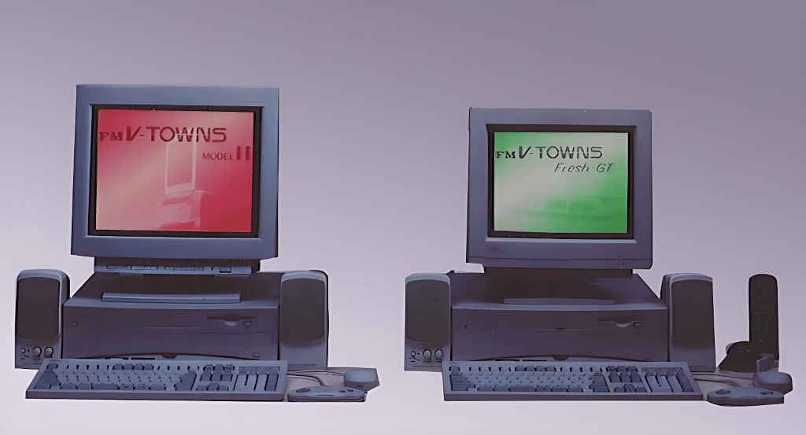

I fully realize that some of you might disagree, and claim that it's more like some sort of a hybrid between a PC and a gaming console of the time, and of course you wouldn't be wrong to say that.

In any case, if this is the first time you are hearing about this machine, just like I have, then you can follow [this link][ipsjfmtowns], and head over to the [IPSJ Computer Museum][ipsjcomputermuseum] in order to learn more about it.

Japan never disappoints when it comes to this kind of stuff, that's for sure.

*Dare-ni mukatte mono itten-dayo! Huh? Huh?*

## Michael Douglas

The [*first-born son*][michaeldouglas] of mighty [Spartacus][kirkdouglas] himself on Joe Rogan? What an insane refresh pull, right?



There are actors, and then *there are actors*, if you get my meaning. What I am really trying to say is that [Michael Douglas][michaeldouglas] happens to be one of those actors who's characters put on the *person-suit* of them,  rather than the other way around. Does that make any sense, like at all?

### [Wall Street (1987)][wallstreet]



### [Fatal Attraction (1987)][fatalattraction]



### [Basic Instinct (1992)][basicinstinct]



### [Falling Down (1993)][fallingdown]



### [Disclosure (1994)][disclosure]



### [A Perfect Murder (1998)][aperfectmurder]



### [Don't Say a Word (2001)][dontsayaword]



### [Solitary Man (2009)][solitaryman]



### [Wall Street: Money Never Sleeps (2010)][wallstreetmoneyneversleeps]



In every single of one of these films, the characters played by *Michael*, temporarily become *Michael*, which is one of the reasons why each of these performances appear to be so effortlessly good.

I would have expected him to retire by now, but he still seems to be going strong from the looks of it.

## s&box: Rethinking

The update titled "[Rethinking][sboxrethinking]" posted by [Gary][gmod], should be on the recommended reading list for anyone who happens to be running a game company at the present moment, irrespective of size.

### sbox-cli

It appears that the embedded *HTTP MCP server* has now been completely *nuked* in favor of the new [sbox-cli][sboxcli] tool.

Since I was rather curious to find out how was this all implemented under the hood, the very the first thing that caught my eye was this very aptly named `CreatePipe` function in `engine/Launcher/SboxCli/Program.cs`:

```c#
static NamedPipeClientStream CreatePipe(Process process) => new(
	".",
    McpWire.PipeName(
		process.Id,
        process.StartTime.ToUniversalTime().Ticks
    ),
    PipeDirection.InOut,
    PipeOptions.Asynchronous | PipeOptions.CurrentUserOnly
);
```

And, then the next point of interest was the implementation of the `McpWrite.PipeName` function:

```c#
internal static string PipeName(int pid, long startTime)
    => $"sbox-mcp-{pid}-{startTime:x}";
```

So, in effect, instead of the old `HTTPServer`, there's now a `PipeServer` that functions more or less the same way, except that it does so through *named pipes*, which are roughly the *Win32* equivalents of good old *Unix domain sockets*.

In the brave new world of `.NET` however, this has all been rather conveniently abstracted away for us in the forms of `NamedPipeClientStream`, and `NamedPipeServerStream` respectively.

Using the `process.StartTime` in the *pipe name* is definitely a nice touch, which has been done in order to avoid running into issues if by any chance an existing `PID` gets recycled.

Personally, I would have done away with the so called *MCP-ness* altogether, but hey, this is already an excellent step in the right direction as far I am concerned.

Here's a link to commit [#fdf695b][sboxclisha], which brings the `sbox-cli` into the mix.

PS: **RIP Terry**.

## KDE: The Documentary

I must confess that I haven't touched [KDE][kde] since `2002` or thereabouts.



## BRUTAL


It quite literally pains me to see that even in the year `2026`, many don't seem to understand that you should never ever [*open source*][opensourcebrutal] anything, if you are looking for *fame*, *recognition*, *credit* or *money*.

The one and only good reason to *open source* a piece of software is to do so in the hope that it might be useful to others in some shape or form, with absolutely no strings attached.

That's it. It's really not that complicated. Just release it, and let nature take its course, if it's meant to be.

## Car Park Capital


The *tycoon genre* is really not my cup of tea, which I am sure that wasn't too hard to guess, but nonetheless I still wanted to call attention to [Car Park Capital][carparkcapital] by [Hilko Janssen][hilkojanssen].



I feel like it's not too far fetched to claim that even [Chris Sawyer][chrissawyer] himself, the *undisputed bona-fide master* of this particular genre would be more than willing to bless this one. You don't even have to take solely my word for it. Just awe a gander at the reviews on Steam for yourself.

The fine folks at [NecroProse][microprose] struck solid gold by picking up this one, and it's not even out of *early access* yet.

## P-rustical

***Oopsy***! Wait, I've been told that the borrow checker would have [prevented][rustissue] all of this. What happened? *Shrugs* ...

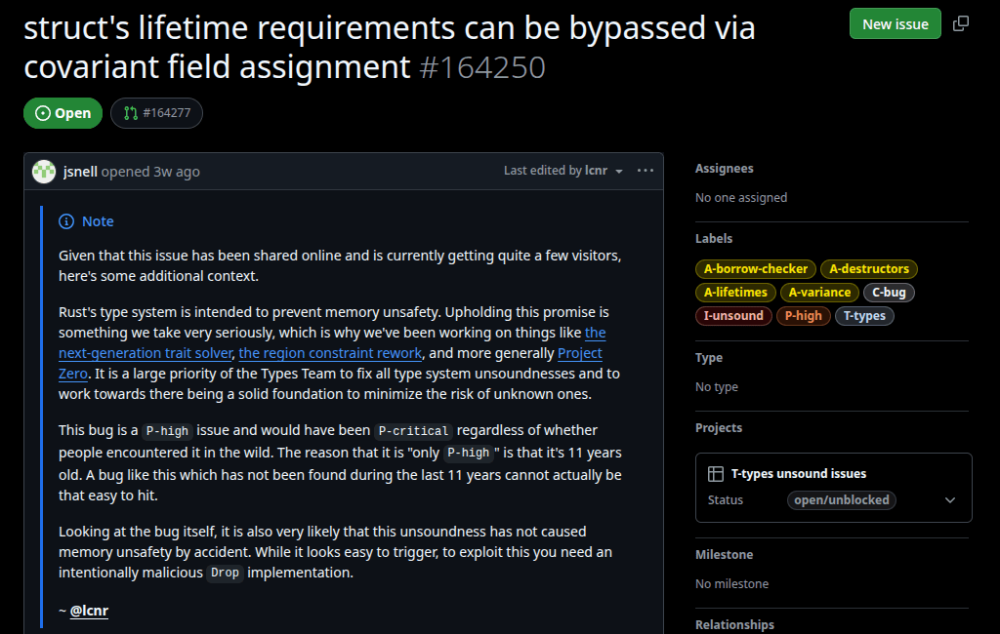

## Kingdom Two Crowns: Pharaoh Lands


After the initial announcement of [Kingdom III: Rising Realms][kingdom3] just two months ago or so, I wasn't expecting there to be a brand new [DLC][kingdomtwocrownsegypt] for [Kingdom: Two Crowns][kingdomtwocrowns].



Speaking of `Kingdom III`, take a look at this *gameplay preview*, that has dropped this month.



## Character.ai

The [voluntary Chapter 11 bankruptcy][chatacteraibankruptcy] of [Character.ai][characterai], really shouldn't come as a surprise to anyone who wasn't born yesterday or the day before yesterday; and the whole *affair* has absolutely nothing to do with *AI* in itself.

How come? Any product that is all about *chat* or *direct messaging* will no doubt come under scrutiny more so than a product dealing *only* with so called *user generated content*. There's just way less *legal* *wiggle-room* as it were.

It doesn't take terribly too long for people to start blaming their own misfortunes, and failures on a product such as this one, rather than facing the fire or fighting their demons on their own time, and their own dime.

We've seen this time and time again, only that this time around, those who happen to suffer from the most severe cases of *socialist brain-rot*, will actually manage to gain the upper-hand, and pretty much get their greatest wish in the form of a *socialist nanny-state* masquerading as *a free society*.

*Dot-products need to be banned effective immediately. Don't you realize, just how dangerous they actually are?*

## The Conjuring: Unspoken


[The Conjuring: Unspoken][conjuringunspoken] is testament to the fact that [Netflix][netflix] is not quite ready to give up on games just yet.



## X: Let's confirm you are human

I've been on *Twitter* since `January, 2008` and this very month I have found myself starring at this superb little screen as illustrated in this absolutely lovely screenshot below.


With no way to access any of the actual functionality, not even the settings. Is this the *brand new age of total abundance* that I keep hearing people talking about on the side-lanes of the *great information-super-highway*?

I am one of those *social-boomers*, who only uses platforms such as **X** (*Twitter*) on the desktop. I can't imagine that I am the only one in this rather elite club, am I right in my assumption?

Why can't I confirm that I am human on the desktop? Why do I have to install the ***X** app* on my phone?

You are not going to like the answers to those questions a tiny bit, let me tell you that. Now, the actual *reason* why is simply because you must perform the *verification* by the means of *biometrics*. Huh, wait what?

There is no other way, there's no alternative method. A phone number? A credit card? Oh no, sir! *Biometrics* only.

If you are thinking to yourself that you'll not be faced with this *challenge*, because you are one of the *people of the great butterfly*, let me clue you in on something that others might not be willing to tell you in an honest fashion ...

This is going to be mandatory for absolutely all access on the *web*, *desktop* and *mobile*, soon enough. No *platform* will be spared, there won't be any place of *refuge* left for you or I for that matter to migrate to in the very near future.

You just wait and see. The *great wheels* have already been put into motion. Enjoy while you still can.

## Ashens Halloween Special: 2026



## Triple-A Minesweeper


[Ttriple-A Miinesweeper][tripleaminesweer] just hits different in every imaginable way. Besides that lovely <code style="color: #008080">#008080</code> is just *chef's kiss*!

## Clive Barker's Hellraiser: Revival

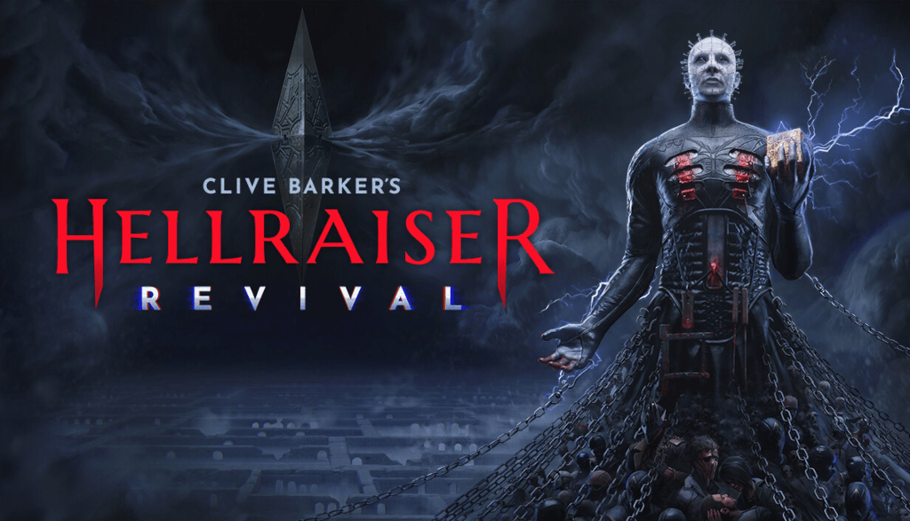

I am of the opinion that perhaps some franchises should continue to remain locked behind the *lament configuration*.



## Layoff-table

The very moment it was [made public][bendingspoonsairtable] that [Bending Spoons][bendingspoons] has entered into an agreement to buy [Airtable][airtable], I  immediately knew that they will announce layoffs shortly after the actual acquisition has gone through.

[Right on cue][airtablebasics], they are "*laying off a large part of the Airtable team*" as they have put it. The fact that Airtable couldn't really stand on its own feet after ingesting round after round, it shows how a great idea alone doesn't always translate into something that is profitable enough to be self-sustaining in the long run.

Their investors did end up getting their *payday* after all, and that's all that matters at the end of the day.

## FilesFound.net

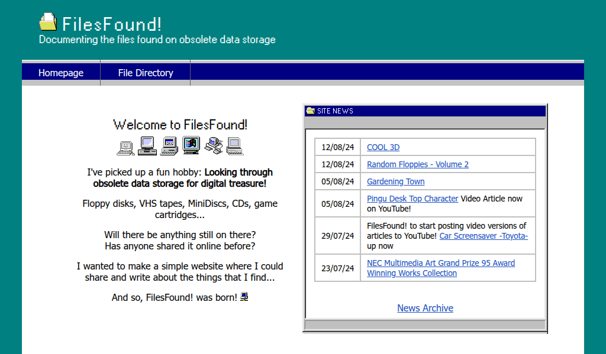

[FilesFound.net][filesfound] is a total treasure trove for anyone interested in *digital archeology*, myself included.

Double <code style="color: #008080">#008080</code> or what?

## [Miss Self Destruct][missselfdestruct]

[Stuck in Attic][stuckinattic] branching out with ***two*** additional games, was most definitely not on my bingo card.

### [Hell Is Other People][hellisotherpeople]




### [No One Will Miss Me][noonewillmissme]

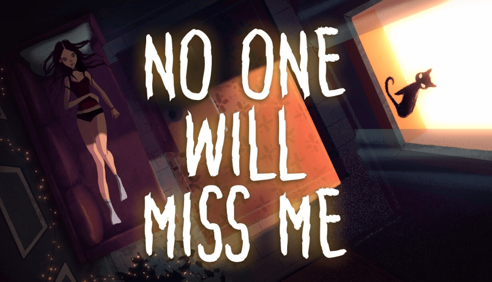



## PHP

I feel like *The Story of PHP documentary*, might need a couple of *extra bonus segments* to be shot *pronto* after the whole [PHP2SHELL][php2shell] fiasco that has went down in the second half of the month.



## Enigma: The Cross of Changes



## GitLab: Rate Limit Edition

> Rate limit exceeded; see https://docs.gitlab.com/user/gitlab_com/rate_limits/ for more details.

How do people put up with this absolute travesty? Besides, how can you compete with GitHub when you rate limited the shit out of your user base?

Did they just *vibe-code* this? As one cannot even login after the rate-limit has kicked in. What a total and utter mess.

When I first saw this being announced earlier, I really thought to myself that there's simply no way that they would go ahead and actually go implement this.

## Diablo: Pre-release Demo

There's something neat about this totally self-contained *pre-release demo version* of the original [Diablo][diablo], that can be found on the [Games Sampler 2 for Windows 95][win95gs2], and requires [DirectX 2.0][dx2] or later.

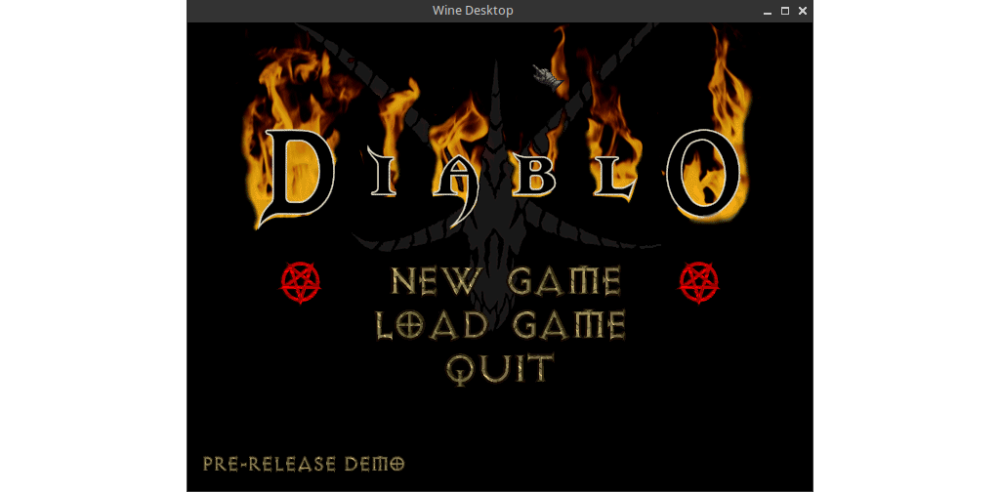

The `DIABLO.EXE` (`50AAF537`) present on the disc seems to weigh a whopping `56` *mega-bytes*.

```bash
$ winedump DIABLO.EXE | head
Contents of DIABLO.EXE: 58586610 bytes

File Header
  Machine:                      014C (i386)
  Number of Sections:           7
  TimeDateStamp:                322609AD (Fri Aug 30 00:20:45 1996)
  PointerToSymbolTable:         00000000
  NumberOfSymbols:              00000000
  SizeOfOptionalHeader:         00E0
  Characteristics:              010E
```

There's an `MPQ` *archive* tucked away at the very end, which is pretty much how [Blizzard][blizzard] was building their installers as well around this time. Except that there's no actual installer this time around.

Let's take a closer look under the hood, and confirm all this.

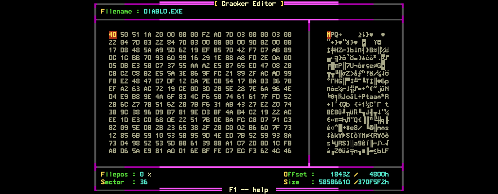

And, now let's confirm that offset `4800h` is indeed the correct one and we haven't just found a totally random sequence of unrelated bytes.

```bash
$ winedump -f DIABLO.EXE | tail
      INITIALIZED_DATA  MEM_READ

  .reloc     VirtSize: 0x000003ce  VirtAddr:  0x00009000
    raw data offs:   0x00004400  raw data size: 0x00000400
    relocation offs: 0x00000000  relocations:   0x00000000
    line # offs:     0         line #'s:      0
    characteristics: 0x42000040
      INITIALIZED_DATA  MEM_DISCARDABLE  MEM_READ

Done dumping DIABLO.EXE
```

The offset of the `4D 50 51 1A 20`  byte sequence matches up with `0x4400 + 0x0400 = 0x4800`.

Without going to deep into the *nerd stuff*, let me just say that the `1A` after the `MPQ` char sequence signifies that it's version `1` of the package format, which in turn also happens to have a header size of `32` (`0x20`).

Wait, does that mean that the executable itself is just a mere `18432` *bytes*? That is correct, and it appears so.



## RenderWare 1.4: Tech Demos

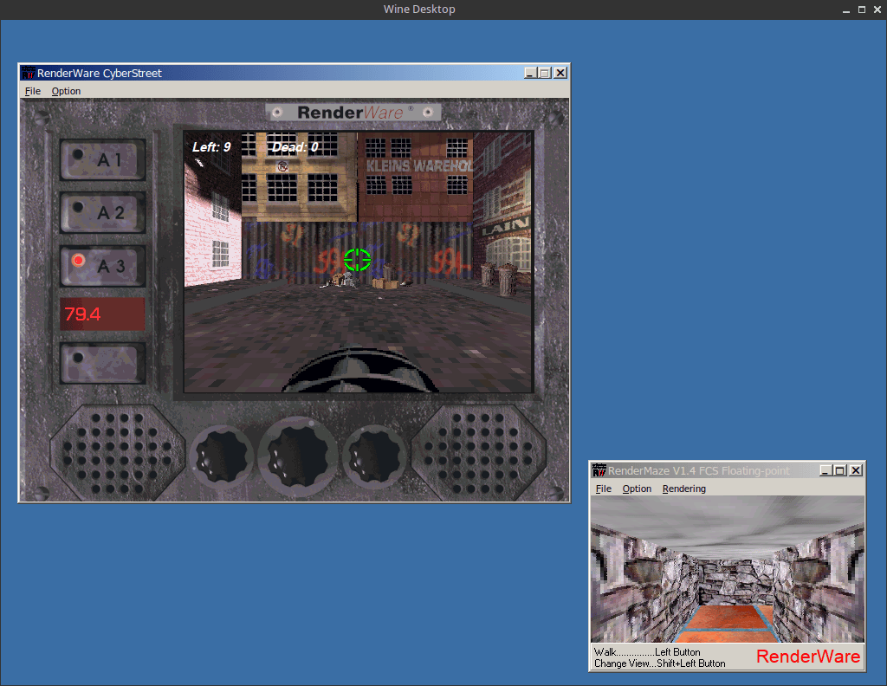

I found this *super-duper-lovely* collection of [RenderWare][renderware] *tech-demos* on the cover disc of the `March, 1996` issue of the [What PC?][whatpc] magazine from the mysterious land of the *UK*.

```bash
$ winedump RWCYBER.EXE | head
Contents of RWCYBER.EXE: 821760 bytes

File Header
  Machine:                      014C (i386)
  Number of Sections:           9
  TimeDateStamp:                2F42BD13 (Thu Feb 16 04:48:51 1995)
  PointerToSymbolTable:         00000000
  NumberOfSymbols:              00000000
  SizeOfOptionalHeader:         00E0
  Characteristics:              010E
```

What were you up to on `February 16, 1995`? Well, not at `04:48:51` of course.

```bash
$ winedump -j import RWCYBER.EXE | grep \.dll
  offset 000b7000 KERNEL32.dll
  offset 000b7014 USER32.dll
  offset 000b7028 GDI32.dll
```

Just *pure* concentrated `GDI32` goodness, which makes total sense considering the fact that [DirectX 2.0][dx2] was more than a year away from seeing the light of day when this was being developed and compiled.

I was pleasantly surprised by the fact that it's all fairly *data-driven* for `1995`. See `SCRIPTS/GUN.RWX` for example:

```lua
ModelBegin
    ProtoBegin Gun
        Vertex -0.5 -0.5 0 UV 0 1
        Vertex  0.5 -0.5 0 UV 1 1
        Vertex  0.5  0.5 0 UV 1 0
        Vertex -0.5  0.5 0 UV 0 0
        TextureMode NULL
        Texture gun Mask gunm
        Quad 1 2 3 4
    ProtoEnd

    ClumpBegin
        Hints NULL
        ProtoInstance Gun
        AxisAlignment zorienty
    ClumpEnd
ModelEnd
```

Here's a direct link to [RWCYBER.ZIP][rwcyber], for those interested in checking this one out on their own for some reason.

## The Code Project

I am glad to say that I am not member of the club that happens to obsess over preserving everything single thing on the great *information-super-highway*, but I consider [the code project][codeproject] to be one of the few *communities* from the *early 2000s* that absolutely should have been crawled and preserved in its entirety.

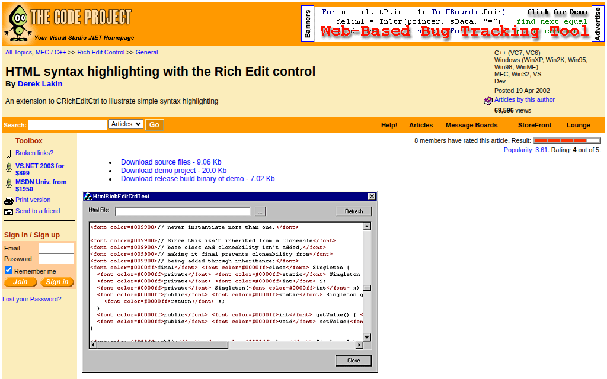

Isn't that all covered by [archive.org][archive.org]? Yes, and no. Yes, because the actual *articles* are relatively well preserved, but pretty much none of the *sample source code*, which used to require one to login to be able to download any of it.

Why am I yapping about it now, you might ask? Well, the reason is that I didn't realize that the whole site went dark somewhere in `October 2024`, after changing hands several times over the years.

I consider it to be in many ways the precursor of what eventually materialized as [Stack Overflow][stackoverflow].

## Insidious: Out of the Further


In case I failed to convince you to make up your mind about [Insidious: Out of the Further][insidious], you are now able to watch the *unadulterated first 10 minutes* in this *extended preview*. Whatever that means, right?



## Zortch 2: Devlog



## ExoWin3x

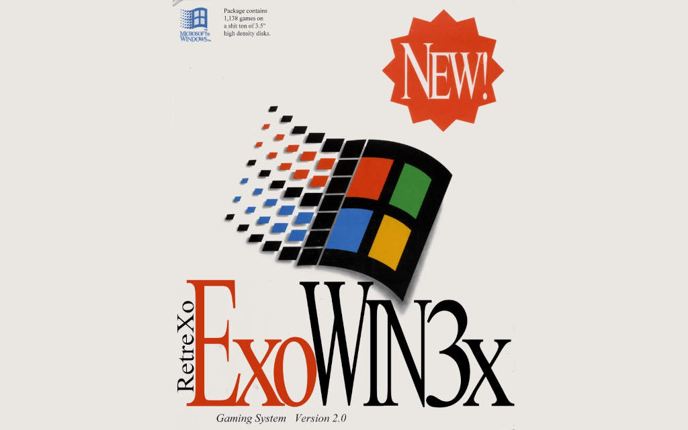

[ExoWin3x][exowin3x] doesn't disappoint, which is to be expected given the previous releases of the RetreXo team.

> This pack includes **1,138** Windows 3x games. Windows 3x was an "operating environment" that ran on DOS.
>
> It preceded Windows 95 which was a proper operating system and did not run on DOS (although it had a DOS mode it could pass over to when needed).
>
> While Windows 3.x (the X standing for either 3.0, 3.1, or 3.11) ran on DOS, it was much more capable of running multi media content.
>
> As CD-ROMs were just beginning to become main stream at this time, this led to an influx of reference, productivity, educational, and FMV games released for the platform.

## Win32 Scroller in C

Staying in the land of projects written in C from my archives, I managed to dig this bad boy out of bog.

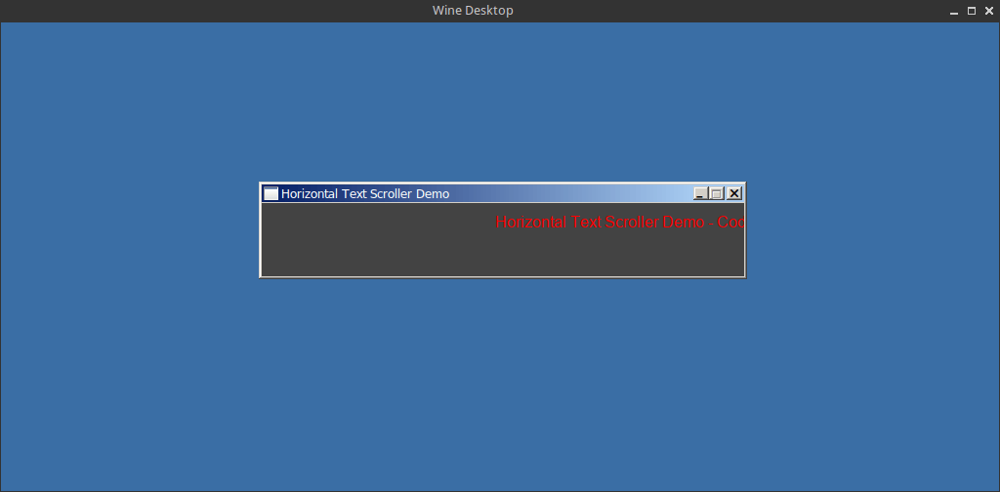

Based on the executable, the last time I have compiled this one was on `December 22, 2005`.

```bash
$ winedump scroll.exe | head
Contents of scroll.exe: 39201 bytes

File Header
  Machine:                      014C (i386)
  Number of Sections:           5
  TimeDateStamp:                43AAC2D4 (Thu Dec 22 17:14:28 2005)
  PointerToSymbolTable:         00004000
  NumberOfSymbols:              00000402
  SizeOfOptionalHeader:         00E0
  Characteristics:              0207
```

And, if you thought to yourself that it was a *long-ass-time-ago*, wait until you see the `fmod.dll` that I ended up using to play the module in the `XM` file format.

```bash
$ winedump fmod.dll | head
Contents of fmod.dll: 154624 bytes

File Header
  Machine:                      014C (i386)
  Number of Sections:           3
  TimeDateStamp:                3FB81B0B (Mon Nov 17 02:49:15 2003)
  PointerToSymbolTable:         00000000
  NumberOfSymbols:              00000000
  SizeOfOptionalHeader:         00E0
  Characteristics:              210E
```

How about that? The code of course is pretty hard to look at today, and is pretty much as terrible as I have expected it to be to be perfectly honest. No surprises to be had here, like at all.

```c
SetTimer(hwnd,ID_TIMER1,TIMER1_INTERVAL,NULL);
SetTimer(hwnd,ID_TIMER2,TIMER2_INTERVAL,NULL);

mod = FMUSIC_LoadSong(MUSIC);
FMUSIC_SetLooping(mod, TRUE);
FMUSIC_PlaySong(mod);
```

Using *timers* not **one**, but **two** whole-ass timers, and naturally no error checking at all.


Take a good look at this beauty that is used for *fading* the background in an out ...

```c
void ChangeBackground(void)
{
  static unsigned int dir = 0;
  if (bgcolor == black ) dir=0;
  if (bgcolor == silver) dir=1;
  if (dir) { bgcolor = FadeOut(bgcolor); } else { bgcolor = FadeIn(bgcolor); }
}
```

I still don't quite understand what *style* I was going for here, but hey it could it be worse. Things are indented at least, that must count for something, right? Sure thing, whatever you say.

So, what about that `XM module`?

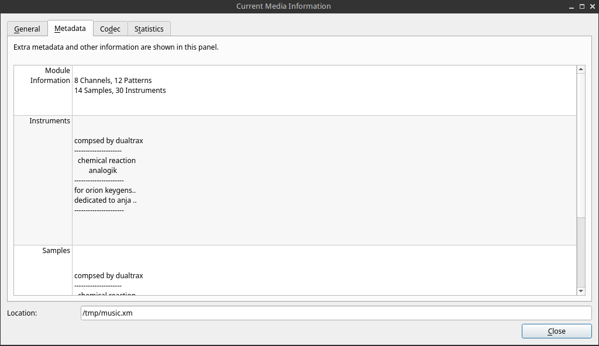

Have a listen below.



I have always remembered writing this exact same *sample* in 32-bit assembly at some point or another, so much so that the C version has totally left my memory palace and took a very long hike it seems.

But don't you worry, we'll take a good look at that version next month, and compare how it all measures up to this absolute *masterpiece*.

*Cough, cough ...*

## The "Sackhoff" Show
















## Monthly Amazon "*Book Review*"

It seems to me that quite a few might recall [Mathematics for 3D Game Programming and Computer Graphics][ericlengyelmath] from the *cyber-drama* that ensued, after [Fabien Sanglard][fabiensanglard] called the book *mostly useless* in the *footnotes* of his [code review][d3bfgsrcreview] of the then recent [DOOM 3: BFG Edition][d3bfg] *source code drop*; a statement which the author of the book, who happened to be none other than [Eric Lengyel][ericlengyel], naturally didn't appreciate a great deal.

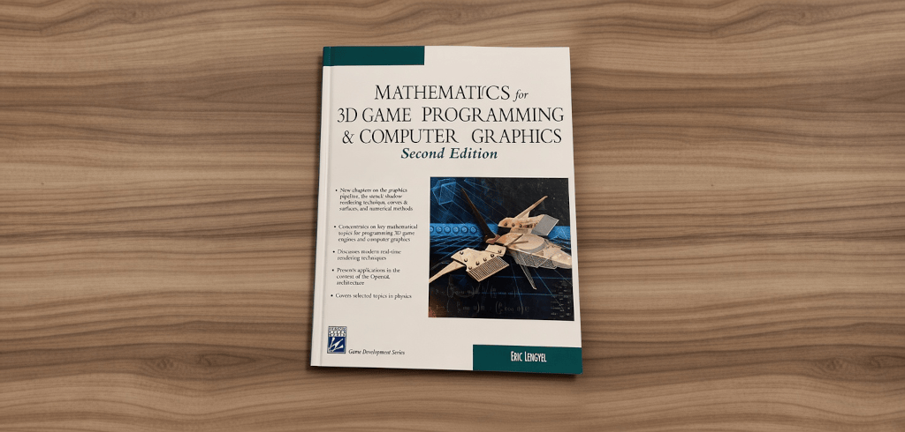

Based on what the great Amazon seems to tell me, I purchased my physical copy on `October 26, 2010`.

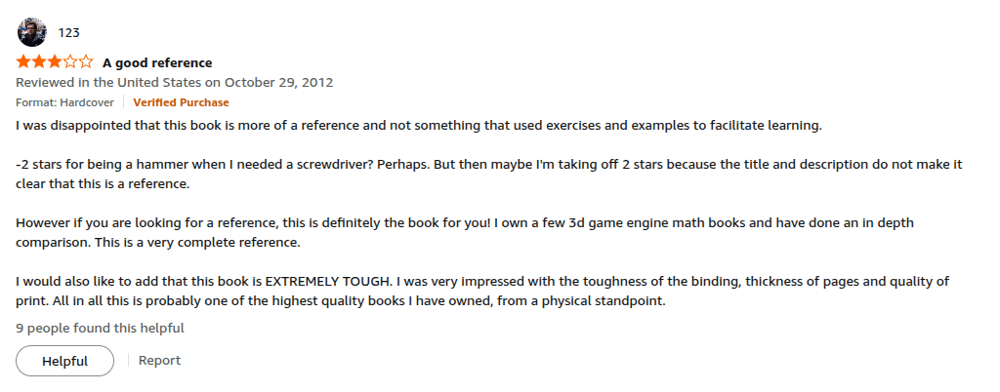

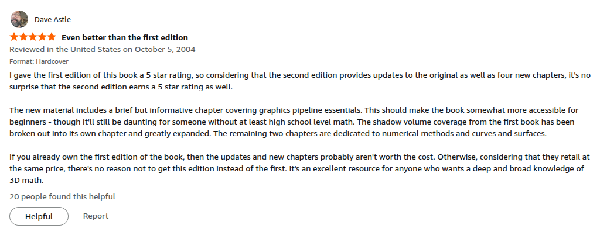

## Monthly *"Coup de cœur"*

Here's another excellent entry in the [musicdisk][musicdisk] category from `September, 2001` by [Rebels][rebels].



I just realized while writing this up that this should have been the one that I selected for my *September retrospective*; what a total and utter miscalculation that was. Oh well, no matter.

Anyway, please enjoy the tunes, and don't forget to try the fish!

[musicdisk]: https://www.pouet.net/prod.php?which=3604
[rebels]: https://www.pouet.net/groups.php?which=524
[ericlengyelmath]: https://www.amazon.com/dp/1584502770
[ericlengyel]: https://terathon.com/lengyel/
[fabiensanglard]: https://fabiensanglard.net/
[d3bfgsrcreview]: https://fabiensanglard.net/doom3_bfg/index.php
[d3bfg]: https://doom.fandom.com/wiki/Doom_3:_BFG_Edition
[codeproject]: https://en.wikipedia.org/wiki/CodeProject
[archive.org]: https://en.wikipedia.org/wiki/Internet_Archive
[stackoverflow]: https://en.wikipedia.org/wiki/Stack_Overflow
[insidious]: https://en.wikipedia.org/wiki/Insidious:_Out_of_the_Further
[exowin3x]: https://wiki.retro-exo.com/index.php/EXOWin3x
[whatpc]: https://archive.org/details/what-pc-mar-96
[renderware]: https://en.wikipedia.org/wiki/RenderWare
[win95gs2]: https://archive.org/details/GamesSampler2ForWindows95Version2
[diablo]: https://en.wikipedia.org/wiki/Diablo_(video_game)
[dx2]: https://en.wikipedia.org/wiki/DirectX#Version_history
[blizzard]: https://en.wikipedia.org/wiki/Blizzard_Entertainment
[php2shell]: https://en.wikipedia.org/wiki/PHP2Shell
[tripleaminesweer]: https://minesweeper.mikelacher.com/
[filesfound]: https://filesfound.net/
[airtablebasics]: https://www.airtable.com/newsroom/back-to-bases
[bendingspoonsairtable]: https://www.businesswire.com/news/home/20260730994716/en/Bending-Spoons-has-entered-into-a-definitive-agreement-to-acquire-Airtable-for-%241.285-billion
[bendingspoons]: https://en.wikipedia.org/wiki/Bending_Spoons
[airtable]: https://en.wikipedia.org/wiki/Airtable
[singularity]: https://en.wikipedia.org/wiki/Singularity_(video_game)
[characterai]: https://en.wikipedia.org/wiki/Character.ai
[chatacteraibankruptcy]: https://blog.character.ai/an-update-on-character-ai/
[rwcyber]: https://archive.org/download/what-pc-mar-96/WHAT_PC_MAR_96.ISO/DEMOS%2FRENDER%2FRWRAT%2FRWCYBER.ZIP
[hellisotherpeople]: https://store.steampowered.com/app/4665880/Hell_Is_Other_People/?curator_clanid=46280285
[noonewillmissme]: https://store.steampowered.com/app/5314220/No_One_Will_Miss_Me/?curator_clanid=46280285
[stuckinattic]: https://store.steampowered.com/developer/stuckinattic/
[missselfdestruct]: https://linktr.ee/miss.self.destruct
[conjuringunspoken]: https://www.netflix.com/tudum/articles/the-conjuring-unspoken-game-news
[netflix]: https://netflix.com
[rustissue]: https://github.com/rust-lang/rust/issues/164250
[carparkcapital]: https://store.steampowered.com/app/3031880/Car_Park_Capital/
[hilkojanssen]: https://x.com/hilkojj
[chrissawyer]: https://en.wikipedia.org/wiki/Chris_Sawyer
[microprose]: https://en.wikipedia.org/wiki/MicroProse
[kde]: https://en.wikipedia.org/wiki/KDE
[opensourcebrutal]: https://github.com/ahwootech/BRUTAL
[kingdom3]: https://store.steampowered.com/app/4822580/Kingdom_III_Rising_Realms/
[kingdomtwocrowns]: https://store.steampowered.com/app/701160/Kingdom_Two_Crowns/
[kingdomtwocrownsegypt]: https://store.steampowered.com/app/4742120/Kingdom_Two_Crowns_Pharaoh_Lands/
[kirkdouglas]: https://en.wikipedia.org/wiki/Kirk_Douglas#Spartacus_and_mid-career
[michaeldouglas]: https://en.wikipedia.org/wiki/Michael_Douglas
[wallstreet]: https://en.wikipedia.org/wiki/Wall_Street_(1987_film)
[fatalattraction]: https://en.wikipedia.org/wiki/Fatal_Attraction
[basicinstinct]: https://en.wikipedia.org/wiki/Basic_Instinct
[fallingdown]: https://en.wikipedia.org/wiki/Falling_Down
[disclosure]: https://en.wikipedia.org/wiki/Disclosure_(1994_film)
[aperfectmurder]: https://en.wikipedia.org/wiki/A_Perfect_Murder
[dontsayaword]: https://en.wikipedia.org/wiki/Don&#39;t_Say_a_Word
[solitaryman]: https://en.wikipedia.org/wiki/Solitary_Man_(film)
[wallstreetmoneyneversleeps]: https://en.wikipedia.org/wiki/Wall_Street:_Money_Never_Sleeps
[sjo]: https://en.wikipedia.org/wiki/Scarlett_Johansson
[exorcist]: https://en.wikipedia.org/wiki/The_Exorcist_(franchise)
[flanagan]: https://en.wikipedia.org/wiki/Mike_Flanagan_(filmmaker)
[typora]: https://typora.io/
[typora2]: https://v2.typora.io/
[hallsoftorment]: https://store.steampowered.com/app/2218750/Halls_of_Torment/
[hallsoftormentthelostarchives]: https://store.steampowered.com/app/4100210/Halls_of_Torment_The_Lost_Archives/?curator_clanid=43496740
[hallsoftormenttheboglands]: https://store.steampowered.com/app/3919420/Halls_of_Torment_The_Boglands/?curator_clanid=43496740
[vampiresurvivors]: https://store.steampowered.com/app/1794680/Vampire_Survivors/
[usenetrewind]: https://www.usenet-rewind.com/
[usenet]: https://en.wikipedia.org/wiki/Usenet
[macworldarchive]: https://vintageapple.org/macworld/
[macworld]: https://en.wikipedia.org/wiki/Macworld
[dos]: https://en.wikipedia.org/wiki/MS-DOS
[demoscene]: https://en.wikipedia.org/wiki/Demoscene
[dosinside]: https://68k-inside.party/dos/
[dosinsideintro]: https://www.pouet.net/prod.php?which=107233
[howmanydudesnewdudes]: https://store.steampowered.com/news/app/3934270/view/684141361612456599?l=english
[underkeep]: https://store.steampowered.com/app/2411200/Underkeep/
[youcanseeeverything]: https://en.wikipedia.org/wiki/You_Can_See_Everything
[nfielder]: https://en.wikipedia.org/wiki/Nathan_Fielder
[eholmes]: https://en.wikipedia.org/wiki/Elizabeth_Holmes
[theranos.world]: https://www.theranos.world/
[spikklubba]: https://spikklubbaspel.itch.io/spikklubba
[sboxrethinking]: https://sbox.game/news/rethinking
[gmod]: https://en.wikipedia.org/wiki/Garry_Newman
[sboxcli]: https://github.com/Facepunch/sbox-public/blob/b66279ca5ff806b3fab3bb31bd8b90c02b447adb/engine/Launcher/SboxCli/skills/sbox-cli/SKILL.md
[sboxclisha]: https://github.com/Facepunch/sbox-public/commit/fdf695b
[ms60k]: https://www.seattletimes.com/business/microsoft/microsoft-offers-mass-buyouts-for-roughly-a-quarter-of-its-workforce/
[homegrowncacao]: https://www.cocoterra.com/guide-on-how-to-grow-chocolate-at-home/
[erlik]: https://store.steampowered.com/app/4917630/ERLIK/
[d2survivors]: https://d2survivors.lol/play/
[fmtowns]: https://en.wikipedia.org/wiki/FM_Towns
[ipsjfmtowns]: https://museum.ipsj.or.jp/en/computer/personal/0060.html
[ipsjcomputermuseum]: https://museum.ipsj.or.jp/en/
