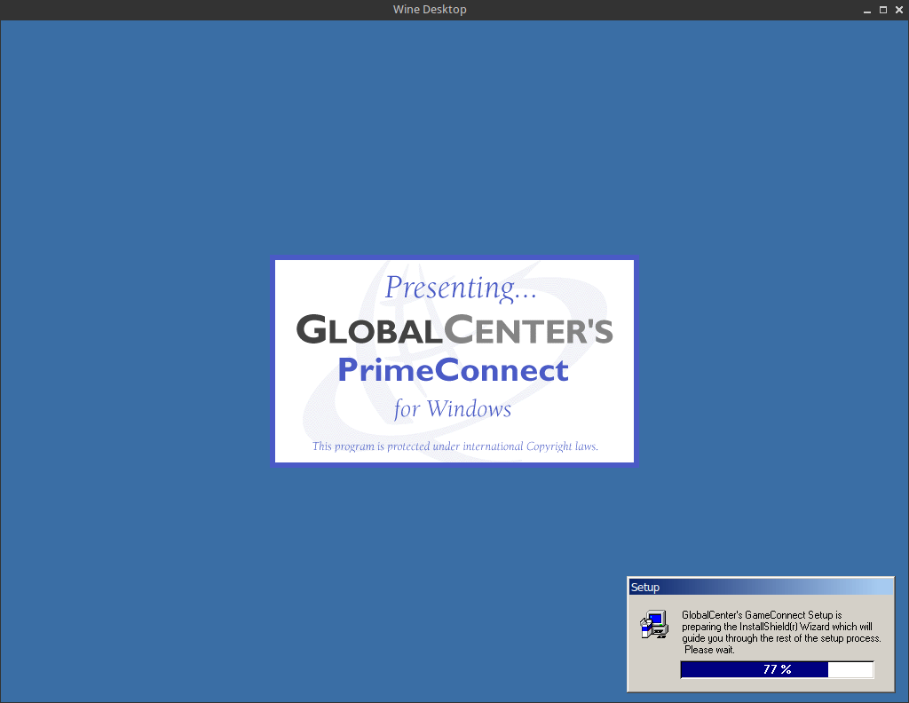
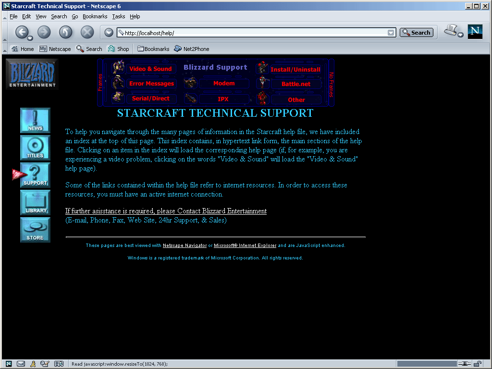
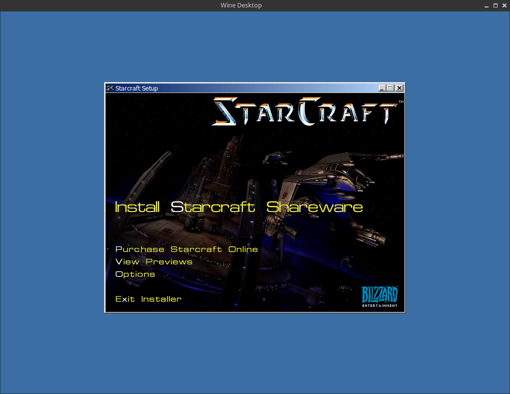
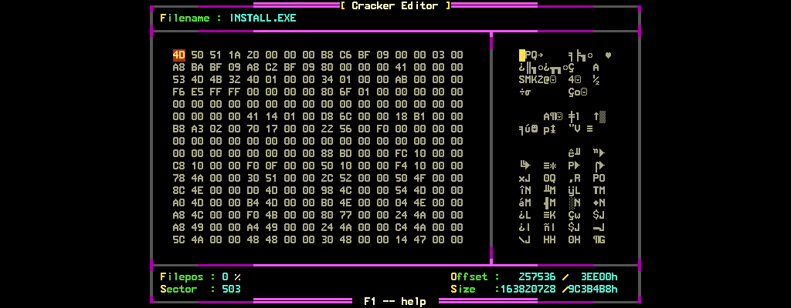
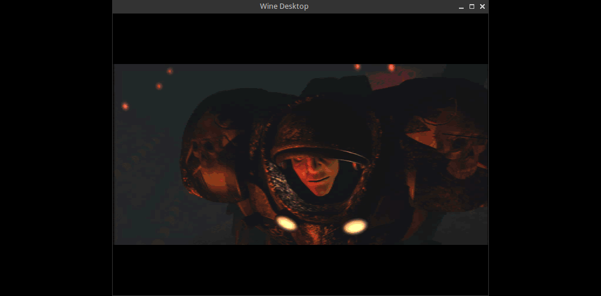
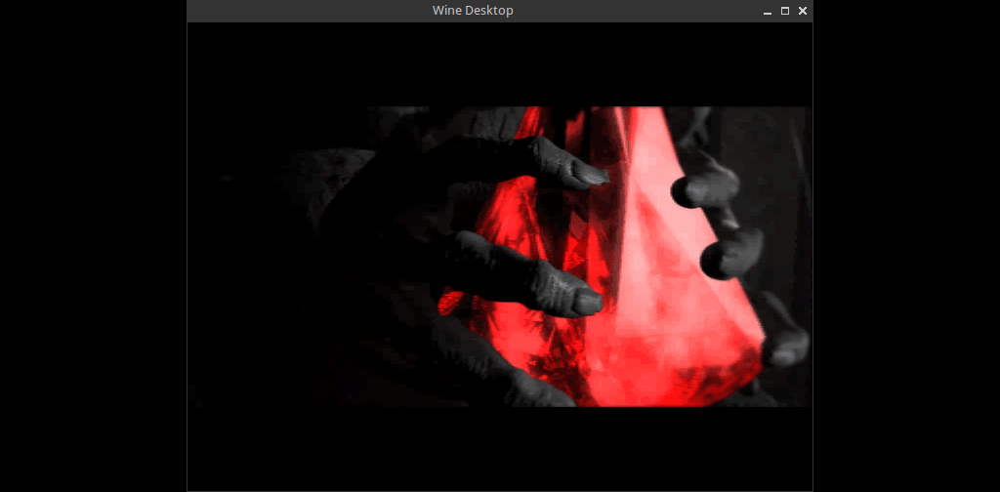
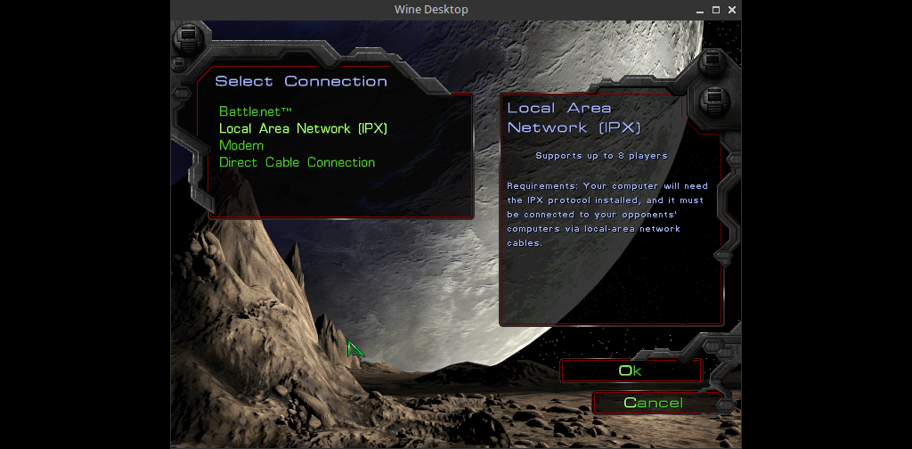
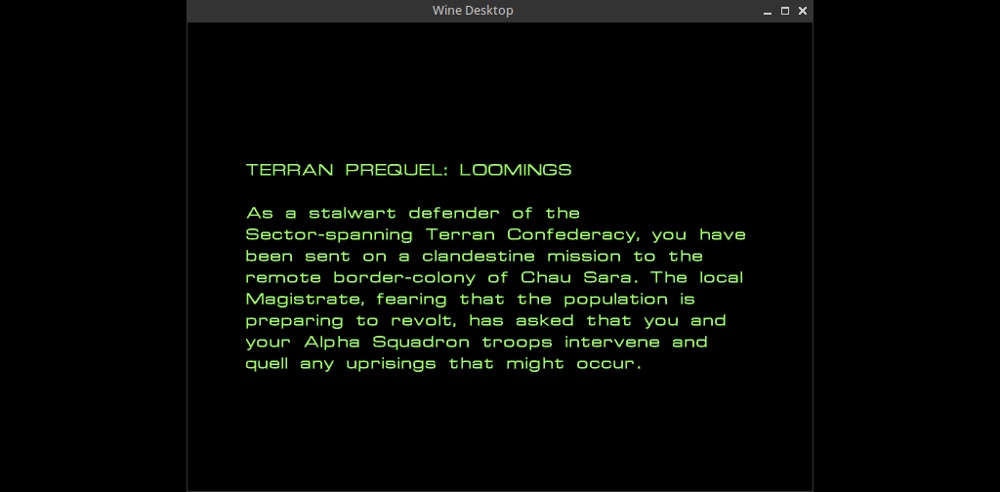
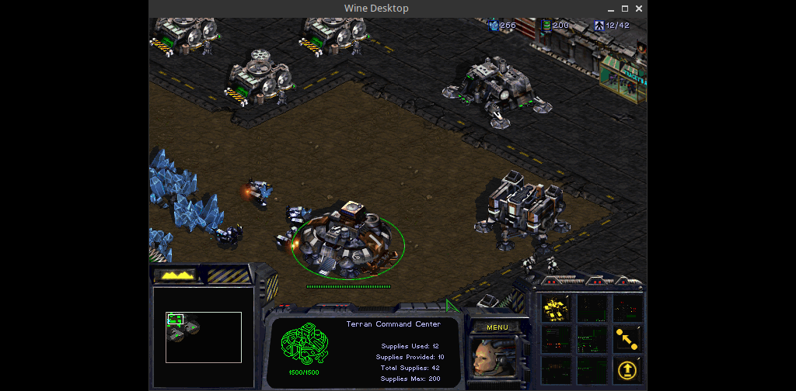

Starcraft Shareware CD
=========================

I might have mentioned this somewhere before, but despite being an avid fan of the [RTS][rts] genre, I never really had a taste for the [Starcraft franchise][starcraftfranchise]. What makes all this even weirder is that I also love *sci-fi* a great deal, but yeah, the whole thing, it just never seemed to *resonate* with me. You know? It's one of those, *"It's not you, it's me!"* type of situations. Or that's what I like to tell myself at least.



Anyway, given that the *recent cinematic announcement trailer* about the upcoming entry in the franchise seemed to have raised some eyebrows in some circles, I have decided to yap a little about the [Starcraft Shareware CD][swcd], which I have stumbled upon earlier in the year, while casually browsing around on the [interwebz archive][archiveorg].

## CD

The CD has been ripped in the `BIN/CUE` format, which meant that I had to convert it to `ISO`, with the `bchunk` utility.

```bash
$ bchunk input.cue input.bin output.iso
```

The resulting `ISO` that has been spit out by running the ancient incantation above is exactly `230686720` bytes or `220` mega-bytes in size, and happens to have an `MD5` checksum of `ad5d17e3d665d16c105ff9b7694ff4b6`.

Next, I generated a `listing` of the `CD` itself, which you can peruse at your leisure by checking out the table below.

| File Name                                   | Last Modified         | Size (Bytes) | CRC32      |
| ------------------------------------------- | --------------------- | ------------ | ---------- |
| `AUTORUN.INF`                               | `1998-01-09 06:06:16` | `40`         | `D0143143` |
| `DIRECTX5/DIRECTX/D3D.INF`                  | `1997-07-14 20:00:00` | `1147`       | `27D532F8` |
| `DIRECTX5/DIRECTX/D3DHALF.DLL`              | `1997-07-14 20:00:00` | `124928`     | `9B16C3B1` |
| `DIRECTX5/DIRECTX/D3DIM.DLL`                | `1997-07-14 20:00:00` | `161792`     | `D32B3D2B` |
| `DIRECTX5/DIRECTX/D3DPMESH.DLL`             | `1997-07-14 20:00:00` | `104448`     | `C77084BB` |
| `DIRECTX5/DIRECTX/D3DRAMPF.DLL`             | `1997-07-14 20:00:00` | `95744`      | `5374A495` |
| `DIRECTX5/DIRECTX/D3DRG16F.DLL`             | `1997-07-14 20:00:00` | `224768`     | `3FB22884` |
| `DIRECTX5/DIRECTX/D3DRG24F.DLL`             | `1997-07-14 20:00:00` | `168448`     | `54E578D9` |
| `DIRECTX5/DIRECTX/D3DRG24X.DLL`             | `1997-07-14 20:00:00` | `172544`     | `A1DD762E` |
| `DIRECTX5/DIRECTX/D3DRG32F.DLL`             | `1997-07-14 20:00:00` | `166912`     | `011B8B1D` |
| `DIRECTX5/DIRECTX/D3DRG32X.DLL`             | `1997-07-14 20:00:00` | `171520`     | `D715931A` |
| `DIRECTX5/DIRECTX/D3DRG55X.DLL`             | `1997-07-14 20:00:00` | `305152`     | `C4460D15` |
| `DIRECTX5/DIRECTX/D3DRG56X.DLL`             | `1997-07-14 20:00:00` | `305152`     | `5C1455AD` |
| `DIRECTX5/DIRECTX/D3DRG8F.DLL`              | `1997-07-14 20:00:00` | `224768`     | `18638CCD` |
| `DIRECTX5/DIRECTX/D3DRG8X.DLL`              | `1997-07-14 20:00:00` | `228352`     | `48005E7E` |
| `DIRECTX5/DIRECTX/D3DRGBF.DLL`              | `1997-07-14 20:00:00` | `96256`      | `D0FCAA7F` |
| `DIRECTX5/DIRECTX/D3DRGBXF.DLL`             | `1997-07-14 20:00:00` | `100864`     | `EE5D2A6D` |
| `DIRECTX5/DIRECTX/D3DRM.DLL`                | `1997-07-14 20:00:00` | `344576`     | `8AF90562` |
| `DIRECTX5/DIRECTX/D3DRM16F.DLL`             | `1997-07-14 20:00:00` | `459264`     | `E725EF66` |
| `DIRECTX5/DIRECTX/D3DRM24F.DLL`             | `1997-07-14 20:00:00` | `125952`     | `2648E733` |
| `DIRECTX5/DIRECTX/D3DRM32F.DLL`             | `1997-07-14 20:00:00` | `125952`     | `45C20269` |
| `DIRECTX5/DIRECTX/D3DRM8F.DLL`              | `1997-07-14 20:00:00` | `458240`     | `9C28DE11` |
| `DIRECTX5/DIRECTX/D3DXOF.DLL`               | `1997-07-14 20:00:00` | `120320`     | `7E0B004A` |
| `DIRECTX5/DIRECTX/DDHELP.EXE`               | `1997-07-14 20:00:00` | `32256`      | `781ACD14` |
| `DIRECTX5/DIRECTX/DDRAW.DLL`                | `1997-07-14 20:00:00` | `270848`     | `B9C4C4B7` |
| `DIRECTX5/DIRECTX/DDRAW.INF`                | `1997-07-14 20:00:00` | `4107`       | `34512E7C` |
| `DIRECTX5/DIRECTX/DDRAW16.DLL`              | `1997-07-14 20:00:00` | `27808`      | `E91ECBF0` |
| `DIRECTX5/DIRECTX/DEVNODE1.DLL`             | `1997-07-14 20:00:00` | `23040`      | `4A27FB31` |
| `DIRECTX5/DIRECTX/DEVNODE2.DLL`             | `1997-07-14 20:00:00` | `7168`       | `0D55B5AE` |
| `DIRECTX5/DIRECTX/DIJOY.HLP`                | `1997-07-14 20:00:00` | `16339`      | `18AE6BB9` |
| `DIRECTX5/DIRECTX/DINP.INF`                 | `1997-07-14 20:00:00` | `4416`       | `A1F20B08` |
| `DIRECTX5/DIRECTX/DINPBRZ.INF`              | `1997-07-14 20:00:00` | `4458`       | `DE2F30CF` |
| `DIRECTX5/DIRECTX/DINPCHS.INF`              | `1997-07-14 20:00:00` | `4370`       | `9F3DFAA2` |
| `DIRECTX5/DIRECTX/DINPCHT.INF`              | `1997-07-14 20:00:00` | `4366`       | `4A4A7A93` |
| `DIRECTX5/DIRECTX/DINPCZE.INF`              | `1997-07-14 20:00:00` | `4394`       | `9D4C8DD5` |
| `DIRECTX5/DIRECTX/DINPDUT.INF`              | `1997-07-14 20:00:00` | `4410`       | `F1F92182` |
| `DIRECTX5/DIRECTX/DINPFRN.INF`              | `1997-07-14 20:00:00` | `4444`       | `5081905F` |
| `DIRECTX5/DIRECTX/DINPGER.INF`              | `1997-07-14 20:00:00` | `4433`       | `6AA2A614` |
| `DIRECTX5/DIRECTX/DINPITN.INF`              | `1997-07-14 20:00:00` | `4453`       | `27D0E29D` |
| `DIRECTX5/DIRECTX/DINPJPN.INF`              | `1997-07-14 20:00:00` | `4397`       | `2A6CD0F4` |
| `DIRECTX5/DIRECTX/DINPKOR.INF`              | `1997-07-14 20:00:00` | `4387`       | `73C6E409` |
| `DIRECTX5/DIRECTX/DINPNEC.INF`              | `1997-07-14 20:00:00` | `4397`       | `2A6CD0F4` |
| `DIRECTX5/DIRECTX/DINPPOL.INF`              | `1997-07-14 20:00:00` | `4389`       | `C05935F6` |
| `DIRECTX5/DIRECTX/DINPRUS.INF`              | `1997-07-14 20:00:00` | `4374`       | `927EE302` |
| `DIRECTX5/DIRECTX/DINPSPA.INF`              | `1997-07-14 20:00:00` | `4491`       | `619B0438` |
| `DIRECTX5/DIRECTX/DINPSPM.INF`              | `1997-07-14 20:00:00` | `4416`       | `A1F20B08` |
| `DIRECTX5/DIRECTX/DINPSWE.INF`              | `1997-07-14 20:00:00` | `4382`       | `6C8E4110` |
| `DIRECTX5/DIRECTX/DINPUT.DLL`               | `1997-07-14 20:00:00` | `175616`     | `9A4175D0` |
| `DIRECTX5/DIRECTX/DINPUT.VXD`               | `1997-07-14 20:00:00` | `16986`      | `09E81FD9` |
| `DIRECTX5/DIRECTX/DIRECTX.INF`              | `1997-07-14 20:00:00` | `5209`       | `41FA192E` |
| `DIRECTX5/DIRECTX/DPLAY.DLL`                | `1997-07-14 20:00:00` | `39936`      | `BB12F168` |
| `DIRECTX5/DIRECTX/DPLAY.INF`                | `1997-07-14 20:00:00` | `2408`       | `1321C469` |
| `DIRECTX5/DIRECTX/DPLAYBRZ.INF`             | `1997-07-14 20:00:00` | `2618`       | `DE75EDFD` |
| `DIRECTX5/DIRECTX/DPLAYDX2.INF`             | `1997-07-14 20:00:00` | `1549`       | `5BF47055` |
| `DIRECTX5/DIRECTX/DPLAYFRN.INF`             | `1997-07-14 20:00:00` | `2614`       | `04BD889F` |
| `DIRECTX5/DIRECTX/DPLAYGER.INF`             | `1997-07-14 20:00:00` | `2629`       | `6F3E705D` |
| `DIRECTX5/DIRECTX/DPLAYITN.INF`             | `1997-07-14 20:00:00` | `2620`       | `00D5C81B` |
| `DIRECTX5/DIRECTX/DPLAYJPN.INF`             | `1997-07-14 20:00:00` | `2394`       | `0AB7C48D` |
| `DIRECTX5/DIRECTX/DPLAYNEC.INF`             | `1997-07-14 20:00:00` | `2303`       | `FFF71364` |
| `DIRECTX5/DIRECTX/DPLAYPOL.INF`             | `1997-07-14 20:00:00` | `2397`       | `082890A9` |
| `DIRECTX5/DIRECTX/DPLAYSPA.INF`             | `1997-07-14 20:00:00` | `2615`       | `46DF44A6` |
| `DIRECTX5/DIRECTX/DPLAYSVR.EXE`             | `1997-07-14 20:00:00` | `23960`      | `864EBBF3` |
| `DIRECTX5/DIRECTX/DPLAYX.DLL`               | `1997-07-14 20:00:00` | `172440`     | `93A57BDC` |
| `DIRECTX5/DIRECTX/DPMODEMX.DLL`             | `1997-07-14 20:00:00` | `81352`      | `39E8813B` |
| `DIRECTX5/DIRECTX/DPSERIAL.DLL`             | `1997-07-14 20:00:00` | `41472`      | `8D3FB037` |
| `DIRECTX5/DIRECTX/DPWSOCK.DLL`              | `1997-07-14 20:00:00` | `24064`      | `1173F3D0` |
| `DIRECTX5/DIRECTX/DPWSOCKX.DLL`             | `1997-07-14 20:00:00` | `47568`      | `BAE63EF6` |
| `DIRECTX5/DIRECTX/DRIVERS/USA/5631_DIG.INI` | `1997-07-14 20:00:00` | `38690`      | `D4BD8F84` |
| `DIRECTX5/DIRECTX/DRIVERS/USA/5631_HWC.INI` | `1997-07-14 20:00:00` | `38120`      | `90B4A25E` |
| `DIRECTX5/DIRECTX/DRIVERS/USA/5631_SWC.INI` | `1997-07-14 20:00:00` | `103445`     | `5BDFE86E` |
| `DIRECTX5/DIRECTX/DRIVERS/USA/8811_DIG.INI` | `1997-07-14 20:00:00` | `33422`      | `940DCFF8` |
| `DIRECTX5/DIRECTX/DRIVERS/USA/8811_HWC.INI` | `1997-07-14 20:00:00` | `34675`      | `D0DF3253` |
| `DIRECTX5/DIRECTX/DRIVERS/USA/8811_SWC.INI` | `1997-07-14 20:00:00` | `36613`      | `6A78E3DC` |
| `DIRECTX5/DIRECTX/DRIVERS/USA/8814_DIG.INI` | `1997-07-14 20:00:00` | `47471`      | `6D910401` |
| `DIRECTX5/DIRECTX/DRIVERS/USA/8814_HWC.INI` | `1997-07-14 20:00:00` | `37651`      | `D8CBCFCB` |
| `DIRECTX5/DIRECTX/DRIVERS/USA/8814_SWC.INI` | `1997-07-14 20:00:00` | `37651`      | `92A5671D` |
| `DIRECTX5/DIRECTX/DRIVERS/USA/ATI.VXD`      | `1997-07-14 20:00:00` | `27427`      | `FD0B84B8` |
| `DIRECTX5/DIRECTX/DRIVERS/USA/ATIM32.DLL`   | `1997-07-14 20:00:00` | `10752`      | `FF5F2A17` |
| `DIRECTX5/DIRECTX/DRIVERS/USA/ATIM32.DRV`   | `1997-07-14 20:00:00` | `99184`      | `E0DC5E1A` |
| `DIRECTX5/DIRECTX/DRIVERS/USA/ATIM64.DLL`   | `1997-07-14 20:00:00` | `18432`      | `8D8A50A5` |
| `DIRECTX5/DIRECTX/DRIVERS/USA/ATIM64.DRV`   | `1997-07-14 20:00:00` | `84992`      | `791EF472` |
| `DIRECTX5/DIRECTX/DRIVERS/USA/ATIM8.DRV`    | `1997-07-14 20:00:00` | `129584`     | `E41A4244` |
| `DIRECTX5/DIRECTX/DRIVERS/USA/ATI_D3D.DLL`  | `1997-07-14 20:00:00` | `169472`     | `1A3B3A88` |
| `DIRECTX5/DIRECTX/DRIVERS/USA/ATI_DD16.DLL` | `1997-07-14 20:00:00` | `10960`      | `690EE665` |
| `DIRECTX5/DIRECTX/DRIVERS/USA/ATI_DD32.DLL` | `1997-07-14 20:00:00` | `335360`     | `9C07FFB2` |
| `DIRECTX5/DIRECTX/DRIVERS/USA/ATI_HAL.DLL`  | `1997-07-14 20:00:00` | `85440`      | `43C0F1F3` |
| `DIRECTX5/DIRECTX/DRIVERS/USA/ATI_M64.DRV`  | `1997-07-14 20:00:00` | `325696`     | `9025A1D4` |
| `DIRECTX5/DIRECTX/DRIVERS/USA/ATI_M64.VXD`  | `1997-07-14 20:00:00` | `29827`      | `F90655A6` |
| `DIRECTX5/DIRECTX/DRIVERS/USA/ATI_VPE.DLL`  | `1997-07-14 20:00:00` | `18944`      | `E23AFCF6` |
| `DIRECTX5/DIRECTX/DRIVERS/USA/AZT16.VXD`    | `1997-07-14 20:00:00` | `26770`      | `EA49427F` |
| `DIRECTX5/DIRECTX/DRIVERS/USA/AZT16C.DRV`   | `1997-07-14 20:00:00` | `42080`      | `C37A098F` |
| `DIRECTX5/DIRECTX/DRIVERS/USA/AZT16W.DRV`   | `1997-07-14 20:00:00` | `43664`      | `2B301F09` |
| `DIRECTX5/DIRECTX/DRIVERS/USA/CHIPMM.DLL`   | `1997-07-14 20:00:00` | `13824`      | `455C6A7B` |
| `DIRECTX5/DIRECTX/DRIVERS/USA/CHIPMM.DRV`   | `1997-07-14 20:00:00` | `53984`      | `717A2D69` |
| `DIRECTX5/DIRECTX/DRIVERS/USA/CHIPMM.VXD`   | `1997-07-14 20:00:00` | `24672`      | `AAA537BC` |
| `DIRECTX5/DIRECTX/DRIVERS/USA/CHIPS.DLL`    | `1997-07-14 20:00:00` | `9216`       | `FE40D704` |
| `DIRECTX5/DIRECTX/DRIVERS/USA/CHIPS.DRV`    | `1997-07-14 20:00:00` | `29280`      | `7D017E31` |
| `DIRECTX5/DIRECTX/DRIVERS/USA/CHIPS.VXD`    | `1997-07-14 20:00:00` | `18591`      | `F69249C4` |
| `DIRECTX5/DIRECTX/DRIVERS/USA/CIRRUS.DLL`   | `1997-07-14 20:00:00` | `23040`      | `E8E5C024` |
| `DIRECTX5/DIRECTX/DRIVERS/USA/CIRRUS.DRV`   | `1997-07-14 20:00:00` | `70704`      | `75DAA092` |
| `DIRECTX5/DIRECTX/DRIVERS/USA/CIRRUS.VXD`   | `1997-07-14 20:00:00` | `18477`      | `51B168E5` |
| `DIRECTX5/DIRECTX/DRIVERS/USA/CIRRUSLG.DLL` | `1997-07-14 20:00:00` | `24576`      | `A5463A38` |
| `DIRECTX5/DIRECTX/DRIVERS/USA/CIRRUSLG.DRV` | `1997-07-14 20:00:00` | `199568`     | `6C89A28D` |
| `DIRECTX5/DIRECTX/DRIVERS/USA/CIRRUSLG.VXD` | `1997-07-14 20:00:00` | `16549`      | `F0E49921` |
| `DIRECTX5/DIRECTX/DRIVERS/USA/CIRRUSMM.DLL` | `1997-07-14 20:00:00` | `46592`      | `28946C61` |
| `DIRECTX5/DIRECTX/DRIVERS/USA/CIRRUSMM.DRV` | `1997-07-14 20:00:00` | `77584`      | `07E59603` |
| `DIRECTX5/DIRECTX/DRIVERS/USA/CLD3D.DLL`    | `1997-07-14 20:00:00` | `402432`     | `6979DCDC` |
| `DIRECTX5/DIRECTX/DRIVERS/USA/CPQ_BB.DLL`   | `1997-07-14 20:00:00` | `3552`       | `F877B50F` |
| `DIRECTX5/DIRECTX/DRIVERS/USA/CSPMAN.DLL`   | `1997-07-14 20:00:00` | `18576`      | `C5C2189F` |
| `DIRECTX5/DIRECTX/DRIVERS/USA/CT_65550.DLL` | `1997-07-14 20:00:00` | `3600`       | `9FA2F457` |
| `DIRECTX5/DIRECTX/DRIVERS/USA/CWBAUDIO.BIN` | `1997-07-14 20:00:00` | `8225`       | `9B6FA66B` |
| `DIRECTX5/DIRECTX/DRIVERS/USA/CWBAUDIO.DRV` | `1997-07-14 20:00:00` | `227904`     | `A6D7566A` |
| `DIRECTX5/DIRECTX/DRIVERS/USA/CWBAUDIO.INF` | `1997-07-14 20:00:00` | `27962`      | `41FD1E34` |
| `DIRECTX5/DIRECTX/DRIVERS/USA/CWBAUDIX.VXD` | `1997-07-14 20:00:00` | `101399`     | `B92C8559` |
| `DIRECTX5/DIRECTX/DRIVERS/USA/CWBFM.DRV`    | `1997-07-14 20:00:00` | `21152`      | `ED798D1F` |
| `DIRECTX5/DIRECTX/DRIVERS/USA/CWBJOY.VXD`   | `1997-07-14 20:00:00` | `8124`       | `1288F021` |
| `DIRECTX5/DIRECTX/DRIVERS/USA/CWBMIDI.DRV`  | `1997-07-14 20:00:00` | `9152`       | `811A4ACA` |
| `DIRECTX5/DIRECTX/DRIVERS/USA/CWBMIDI.VXD`  | `1997-07-14 20:00:00` | `14513`      | `B757C07F` |
| `DIRECTX5/DIRECTX/DRIVERS/USA/CWBPCPLE.DLL` | `1997-07-14 20:00:00` | `38912`      | `40E863E4` |
| `DIRECTX5/DIRECTX/DRIVERS/USA/DRIVERS.DDB`  | `1997-07-14 20:00:00` | `16342`      | `994140CE` |
| `DIRECTX5/DIRECTX/DRIVERS/USA/DXATI.INF`    | `1997-07-14 20:00:00` | `9752`       | `618B180D` |
| `DIRECTX5/DIRECTX/DRIVERS/USA/DXCHIPS.INF`  | `1997-07-14 20:00:00` | `5283`       | `02DDF901` |
| `DIRECTX5/DIRECTX/DRIVERS/USA/DXCIRRUS.INF` | `1997-07-14 20:00:00` | `9815`       | `C3FEE8D5` |
| `DIRECTX5/DIRECTX/DRIVERS/USA/DXGLINT.INF`  | `1997-07-14 20:00:00` | `531`        | `5242EB42` |
| `DIRECTX5/DIRECTX/DRIVERS/USA/DXI128.INF`   | `1997-07-14 20:00:00` | `2931`       | `63FA318D` |
| `DIRECTX5/DIRECTX/DRIVERS/USA/DXMGA.INF`    | `1997-07-14 20:00:00` | `2398`       | `13399F19` |
| `DIRECTX5/DIRECTX/DRIVERS/USA/DXMM3DFX.INF` | `1997-07-14 20:00:00` | `1578`       | `49B2C6E1` |
| `DIRECTX5/DIRECTX/DRIVERS/USA/DXNEOM.INF`   | `1997-07-14 20:00:00` | `2257`       | `1E937402` |
| `DIRECTX5/DIRECTX/DRIVERS/USA/DXPMEDIA.INF` | `1997-07-14 20:00:00` | `6296`       | `2F8F70AF` |
| `DIRECTX5/DIRECTX/DRIVERS/USA/DXREND.INF`   | `1997-07-14 20:00:00` | `3717`       | `C2032B1F` |
| `DIRECTX5/DIRECTX/DRIVERS/USA/DXS3.INF`     | `1997-07-14 20:00:00` | `17315`      | `C3585899` |
| `DIRECTX5/DIRECTX/DRIVERS/USA/DXTRID.INF`   | `1997-07-14 20:00:00` | `2571`       | `05C769B4` |
| `DIRECTX5/DIRECTX/DRIVERS/USA/DXTSENG.INF`  | `1997-07-14 20:00:00` | `5961`       | `8B87C8FB` |
| `DIRECTX5/DIRECTX/DRIVERS/USA/DXVER.INF`    | `1997-07-14 20:00:00` | `209`        | `91129B23` |
| `DIRECTX5/DIRECTX/DRIVERS/USA/DXWD.INF`     | `1997-07-14 20:00:00` | `3579`       | `9E60DD2A` |
| `DIRECTX5/DIRECTX/DRIVERS/USA/DX_VER.DLL`   | `1997-07-14 20:00:00` | `3952`       | `B76B44C5` |
| `DIRECTX5/DIRECTX/DRIVERS/USA/ES1488.DRV`   | `1997-07-14 20:00:00` | `43936`      | `C5C1CF40` |
| `DIRECTX5/DIRECTX/DRIVERS/USA/ES1488.VXD`   | `1997-07-14 20:00:00` | `20116`      | `501DB807` |
| `DIRECTX5/DIRECTX/DRIVERS/USA/ES1688.DRV`   | `1997-07-14 20:00:00` | `56192`      | `94EDC15E` |
| `DIRECTX5/DIRECTX/DRIVERS/USA/ES1688.VXD`   | `1997-07-14 20:00:00` | `32382`      | `481B3A09` |
| `DIRECTX5/DIRECTX/DRIVERS/USA/ES1788.DRV`   | `1997-07-14 20:00:00` | `57472`      | `5041C9AE` |
| `DIRECTX5/DIRECTX/DRIVERS/USA/ES1788.VXD`   | `1997-07-14 20:00:00` | `32382`      | `24701299` |
| `DIRECTX5/DIRECTX/DRIVERS/USA/ES488.DRV`    | `1997-07-14 20:00:00` | `36976`      | `D8B08D2E` |
| `DIRECTX5/DIRECTX/DRIVERS/USA/ES488.VXD`    | `1997-07-14 20:00:00` | `19603`      | `D9FF6E66` |
| `DIRECTX5/DIRECTX/DRIVERS/USA/ES688.DRV`    | `1997-07-14 20:00:00` | `47008`      | `2B9C6B3D` |
| `DIRECTX5/DIRECTX/DRIVERS/USA/ES688.VXD`    | `1997-07-14 20:00:00` | `22675`      | `099ACB25` |
| `DIRECTX5/DIRECTX/DRIVERS/USA/ESFM.DRV`     | `1997-07-14 20:00:00` | `20320`      | `ED6C6D2D` |
| `DIRECTX5/DIRECTX/DRIVERS/USA/ESSFM.DRV`    | `1997-07-14 20:00:00` | `17920`      | `ABD9A3D7` |
| `DIRECTX5/DIRECTX/DRIVERS/USA/ESSMPORT.DRV` | `1997-07-14 20:00:00` | `9904`       | `72E8683D` |
| `DIRECTX5/DIRECTX/DRIVERS/USA/ESSMPU.DRV`   | `1997-07-14 20:00:00` | `9776`       | `6212FEC2` |
| `DIRECTX5/DIRECTX/DRIVERS/USA/ET6000.DLL`   | `1997-07-14 20:00:00` | `41472`      | `2E593445` |
| `DIRECTX5/DIRECTX/DRIVERS/USA/ET6000.DRV`   | `1997-07-14 20:00:00` | `69920`      | `050C3B2B` |
| `DIRECTX5/DIRECTX/DRIVERS/USA/ET6000.VXD`   | `1997-07-14 20:00:00` | `17443`      | `3376713A` |
| `DIRECTX5/DIRECTX/DRIVERS/USA/F3AUDIO.INF`  | `1997-07-14 20:00:00` | `6500`       | `468FC1FE` |
| `DIRECTX5/DIRECTX/DRIVERS/USA/F3DRIVER.VXD` | `1997-07-14 20:00:00` | `87152`      | `AA666B7A` |
| `DIRECTX5/DIRECTX/DRIVERS/USA/F3DSOUND.VXD` | `1997-07-14 20:00:00` | `96851`      | `3BA71F86` |
| `DIRECTX5/DIRECTX/DRIVERS/USA/F3JOYSTK.VXD` | `1997-07-14 20:00:00` | `5945`       | `3CB23027` |
| `DIRECTX5/DIRECTX/DRIVERS/USA/F3MIDI.DRV`   | `1997-07-14 20:00:00` | `8720`       | `A9574A3E` |
| `DIRECTX5/DIRECTX/DRIVERS/USA/F3VRTSB.VXD`  | `1997-07-14 20:00:00` | `23160`      | `C93C9AAA` |
| `DIRECTX5/DIRECTX/DRIVERS/USA/F3WAVMIX.DRV` | `1997-07-14 20:00:00` | `47504`      | `79FB1377` |
| `DIRECTX5/DIRECTX/DRIVERS/USA/FINDMVI.DLL`  | `1997-07-14 20:00:00` | `5728`       | `C42C378C` |
| `DIRECTX5/DIRECTX/DRIVERS/USA/FRAMEBUF.DLL` | `1997-07-14 20:00:00` | `8192`       | `3FD23F1D` |
| `DIRECTX5/DIRECTX/DRIVERS/USA/FRAMEBUF.DRV` | `1997-07-14 20:00:00` | `22192`      | `945650C2` |
| `DIRECTX5/DIRECTX/DRIVERS/USA/I128.DLL`     | `1997-07-14 20:00:00` | `115200`     | `48E192FB` |
| `DIRECTX5/DIRECTX/DRIVERS/USA/I128.DRV`     | `1997-07-14 20:00:00` | `42624`      | `3A0E6457` |
| `DIRECTX5/DIRECTX/DRIVERS/USA/I128.VXD`     | `1997-07-14 20:00:00` | `14972`      | `956249B8` |
| `DIRECTX5/DIRECTX/DRIVERS/USA/ISNA.DLL`     | `1997-07-14 20:00:00` | `6064`       | `4710CA8F` |
| `DIRECTX5/DIRECTX/DRIVERS/USA/ISS3_765.DLL` | `1997-07-14 20:00:00` | `3520`       | `605887A2` |
| `DIRECTX5/DIRECTX/DRIVERS/USA/LICENSE.TXT`  | `1997-07-14 20:00:00` | `1315`       | `EDA049D8` |
| `DIRECTX5/DIRECTX/DRIVERS/USA/MGALLX64.DLL` | `1997-07-14 20:00:00` | `96304`      | `C5746853` |
| `DIRECTX5/DIRECTX/DRIVERS/USA/MGAPDX64.DRV` | `1997-07-14 20:00:00` | `125984`     | `4CA5E364` |
| `DIRECTX5/DIRECTX/DRIVERS/USA/MGAPDX64.VXD` | `1997-07-14 20:00:00` | `31798`      | `C56D4266` |
| `DIRECTX5/DIRECTX/DRIVERS/USA/MGAXDD.DRV`   | `1997-07-14 20:00:00` | `21532`      | `F00B70D4` |
| `DIRECTX5/DIRECTX/DRIVERS/USA/MGAXDD.VXD`   | `1997-07-14 20:00:00` | `9846`       | `37C42FAD` |
| `DIRECTX5/DIRECTX/DRIVERS/USA/MGAXDD32.DLL` | `1997-07-14 20:00:00` | `225792`     | `C92A7714` |
| `DIRECTX5/DIRECTX/DRIVERS/USA/MM3DFX.DRV`   | `1997-07-14 20:00:00` | `12592`      | `90031E68` |
| `DIRECTX5/DIRECTX/DRIVERS/USA/MM3DFX.VXD`   | `1997-07-14 20:00:00` | `6077`       | `74BD7B38` |
| `DIRECTX5/DIRECTX/DRIVERS/USA/MM3DFX16.DLL` | `1997-07-14 20:00:00` | `4816`       | `C65A6D3F` |
| `DIRECTX5/DIRECTX/DRIVERS/USA/MM3DFX32.DLL` | `1997-07-14 20:00:00` | `220672`     | `81C0ED71` |
| `DIRECTX5/DIRECTX/DRIVERS/USA/MMMIXER.DLL`  | `1997-07-14 20:00:00` | `5152`       | `3073AFBE` |
| `DIRECTX5/DIRECTX/DRIVERS/USA/MSANALOG.VXD` | `1997-07-14 20:00:00` | `12101`      | `91825852` |
| `DIRECTX5/DIRECTX/DRIVERS/USA/MSDDRAW.INF`  | `1997-07-14 20:00:00` | `386`        | `0FB4C834` |
| `DIRECTX5/DIRECTX/DRIVERS/USA/MSDSOUND.INF` | `1997-07-14 20:00:00` | `313`        | `519757E6` |
| `DIRECTX5/DIRECTX/DRIVERS/USA/MSJSTICK.DRV` | `1997-07-14 20:00:00` | `7744`       | `5B28201A` |
| `DIRECTX5/DIRECTX/DRIVERS/USA/MSMPU401.DRV` | `1997-07-14 20:00:00` | `8704`       | `07E0B99C` |
| `DIRECTX5/DIRECTX/DRIVERS/USA/MSOPL.DRV`    | `1997-07-14 20:00:00` | `17952`      | `8C7E6981` |
| `DIRECTX5/DIRECTX/DRIVERS/USA/MSSBLST.DRV`  | `1997-07-14 20:00:00` | `40848`      | `1549348C` |
| `DIRECTX5/DIRECTX/DRIVERS/USA/MSSBLST.VXD`  | `1997-07-14 20:00:00` | `21154`      | `C61FC9D0` |
| `DIRECTX5/DIRECTX/DRIVERS/USA/MSSNDSYS.DRV` | `1997-07-14 20:00:00` | `40816`      | `7E1AC110` |
| `DIRECTX5/DIRECTX/DRIVERS/USA/MSSNDSYS.VXD` | `1997-07-14 20:00:00` | `31472`      | `27BBDFFB` |
| `DIRECTX5/DIRECTX/DRIVERS/USA/MVI514MX.DRV` | `1997-07-14 20:00:00` | `38432`      | `CCA1BBD8` |
| `DIRECTX5/DIRECTX/DRIVERS/USA/MVIWAVE.DRV`  | `1997-07-14 20:00:00` | `19760`      | `3DBE4157` |
| `DIRECTX5/DIRECTX/DRIVERS/USA/MVMIXER.DRV`  | `1997-07-14 20:00:00` | `59568`      | `CE0276B8` |
| `DIRECTX5/DIRECTX/DRIVERS/USA/MVPAS.VXD`    | `1997-07-14 20:00:00` | `8898`       | `5D4B2F3A` |
| `DIRECTX5/DIRECTX/DRIVERS/USA/MVPROAUD.DRV` | `1997-07-14 20:00:00` | `26128`      | `156AE18F` |
| `DIRECTX5/DIRECTX/DRIVERS/USA/NEOM.DLL`     | `1997-07-14 20:00:00` | `15360`      | `5BF327EE` |
| `DIRECTX5/DIRECTX/DRIVERS/USA/NEOM.DRV`     | `1997-07-14 20:00:00` | `70128`      | `5659927F` |
| `DIRECTX5/DIRECTX/DRIVERS/USA/NEOM.VXD`     | `1997-07-14 20:00:00` | `16119`      | `BFAC10E7` |
| `DIRECTX5/DIRECTX/DRIVERS/USA/OAK.VXD`      | `1997-07-14 20:00:00` | `14477`      | `CED45781` |
| `DIRECTX5/DIRECTX/DRIVERS/USA/PA3DMXD.DRV`  | `1997-07-14 20:00:00` | `53200`      | `FF6E0437` |
| `DIRECTX5/DIRECTX/DRIVERS/USA/PMEDIA.DRV`   | `1997-07-14 20:00:00` | `57696`      | `C54400E7` |
| `DIRECTX5/DIRECTX/DRIVERS/USA/PMEDIA.VXD`   | `1997-07-14 20:00:00` | `45329`      | `F2D53ED0` |
| `DIRECTX5/DIRECTX/DRIVERS/USA/PMEDIA32.DLL` | `1997-07-14 20:00:00` | `371200`     | `8A47E9B3` |
| `DIRECTX5/DIRECTX/DRIVERS/USA/REND.DRV`     | `1997-07-14 20:00:00` | `51344`      | `965DADA3` |
| `DIRECTX5/DIRECTX/DRIVERS/USA/REND.VXD`     | `1997-07-14 20:00:00` | `10851`      | `50F21E7F` |
| `DIRECTX5/DIRECTX/DRIVERS/USA/REND2D.UC`    | `1997-07-14 20:00:00` | `22213`      | `979E7A1F` |
| `DIRECTX5/DIRECTX/DRIVERS/USA/REND32.DLL`   | `1997-07-14 20:00:00` | `295424`     | `71B83292` |
| `DIRECTX5/DIRECTX/DRIVERS/USA/REND3D.UC`    | `1997-07-14 20:00:00` | `70905`      | `0CD071E1` |
| `DIRECTX5/DIRECTX/DRIVERS/USA/RENDUC.DLL`   | `1997-07-14 20:00:00` | `21488`      | `724B43BC` |
| `DIRECTX5/DIRECTX/DRIVERS/USA/S3.DLL`       | `1997-07-14 20:00:00` | `33792`      | `BE5E94DC` |
| `DIRECTX5/DIRECTX/DRIVERS/USA/S3.DRV`       | `1997-07-14 20:00:00` | `136352`     | `08E2BA55` |
| `DIRECTX5/DIRECTX/DRIVERS/USA/S3.VXD`       | `1997-07-14 20:00:00` | `33854`      | `D45C2D72` |
| `DIRECTX5/DIRECTX/DRIVERS/USA/S3M65.DLL`    | `1997-07-14 20:00:00` | `27136`      | `095C5FF2` |
| `DIRECTX5/DIRECTX/DRIVERS/USA/S3M65.DRV`    | `1997-07-14 20:00:00` | `141952`     | `D5FA3026` |
| `DIRECTX5/DIRECTX/DRIVERS/USA/S3M65.VXD`    | `1997-07-14 20:00:00` | `25811`      | `53C193AB` |
| `DIRECTX5/DIRECTX/DRIVERS/USA/S3MM.DLL`     | `1997-07-14 20:00:00` | `74240`      | `1BB8A7BA` |
| `DIRECTX5/DIRECTX/DRIVERS/USA/S3MM.DRV`     | `1997-07-14 20:00:00` | `142736`     | `4C73053B` |
| `DIRECTX5/DIRECTX/DRIVERS/USA/S3V.DLL`      | `1997-07-14 20:00:00` | `326144`     | `4C5181AE` |
| `DIRECTX5/DIRECTX/DRIVERS/USA/S3V.DRV`      | `1997-07-14 20:00:00` | `117296`     | `A1F9EDCC` |
| `DIRECTX5/DIRECTX/DRIVERS/USA/S3_CP3CQ.DLL` | `1997-07-14 20:00:00` | `4560`       | `ADEF4501` |
| `DIRECTX5/DIRECTX/DRIVERS/USA/SB16.VXD`     | `1997-07-14 20:00:00` | `114237`     | `149D4AD8` |
| `DIRECTX5/DIRECTX/DRIVERS/USA/SB16AWE.INF`  | `1997-07-14 20:00:00` | `28317`      | `AC52C5CC` |
| `DIRECTX5/DIRECTX/DRIVERS/USA/SB16SND.DRV`  | `1997-07-14 20:00:00` | `75392`      | `3669716F` |
| `DIRECTX5/DIRECTX/DRIVERS/USA/SBAWE.VXD`    | `1997-07-14 20:00:00` | `78954`      | `E5316648` |
| `DIRECTX5/DIRECTX/DRIVERS/USA/SBAWE32.DRV`  | `1997-07-14 20:00:00` | `31456`      | `205E7645` |
| `DIRECTX5/DIRECTX/DRIVERS/USA/SBFM.DRV`     | `1997-07-14 20:00:00` | `4128`       | `E6525BEE` |
| `DIRECTX5/DIRECTX/DRIVERS/USA/SUPERVGA.DRV` | `1997-07-14 20:00:00` | `52320`      | `1CD27154` |
| `DIRECTX5/DIRECTX/DRIVERS/USA/SYNTHGM.SBK`  | `1997-07-14 20:00:00` | `34832`      | `0EEFB472` |
| `DIRECTX5/DIRECTX/DRIVERS/USA/TMV1.MPD`     | `1997-07-14 20:00:00` | `12048`      | `1290DB92` |
| `DIRECTX5/DIRECTX/DRIVERS/USA/TRID_BIO.DLL` | `1997-07-14 20:00:00` | `30400`      | `38B069CF` |
| `DIRECTX5/DIRECTX/DRIVERS/USA/TRID_PCI.DLL` | `1997-07-14 20:00:00` | `22016`      | `1844ADC8` |
| `DIRECTX5/DIRECTX/DRIVERS/USA/TRID_PCI.DRV` | `1997-07-14 20:00:00` | `50096`      | `970D96E2` |
| `DIRECTX5/DIRECTX/DRIVERS/USA/TRID_PCI.VXD` | `1997-07-14 20:00:00` | `14313`      | `45D804FE` |
| `DIRECTX5/DIRECTX/DRIVERS/USA/TSD32.DLL`    | `1997-07-14 20:00:00` | `17408`      | `15FCA251` |
| `DIRECTX5/DIRECTX/DRIVERS/USA/TSENG.DLL`    | `1997-07-14 20:00:00` | `10240`      | `E061A330` |
| `DIRECTX5/DIRECTX/DRIVERS/USA/TSENG.DRV`    | `1997-07-14 20:00:00` | `37824`      | `1131A235` |
| `DIRECTX5/DIRECTX/DRIVERS/USA/TSENG.VXD`    | `1997-07-14 20:00:00` | `14536`      | `C240468D` |
| `DIRECTX5/DIRECTX/DRIVERS/USA/VGA.DRV`      | `1997-07-14 20:00:00` | `52064`      | `C7993BDE` |
| `DIRECTX5/DIRECTX/DRIVERS/USA/VIDEO7.VXD`   | `1997-07-14 20:00:00` | `14943`      | `0772D906` |
| `DIRECTX5/DIRECTX/DRIVERS/USA/VJOYD.VXD`    | `1997-07-14 20:00:00` | `30320`      | `20393E29` |
| `DIRECTX5/DIRECTX/DRIVERS/USA/VMVID.VXD`    | `1997-07-14 20:00:00` | `18586`      | `CEC1F3EB` |
| `DIRECTX5/DIRECTX/DRIVERS/USA/VPASD.VXD`    | `1997-07-14 20:00:00` | `24162`      | `EE97B685` |
| `DIRECTX5/DIRECTX/DRIVERS/USA/VWSTREAM.VXD` | `1997-07-14 20:00:00` | `5175`       | `73BFB0D6` |
| `DIRECTX5/DIRECTX/DRIVERS/USA/WAVE.INF`     | `1997-07-14 20:00:00` | `58179`      | `954D6F7C` |
| `DIRECTX5/DIRECTX/DRIVERS/USA/WD.DLL`       | `1997-07-14 20:00:00` | `10752`      | `15F39A50` |
| `DIRECTX5/DIRECTX/DRIVERS/USA/WD.DRV`       | `1997-07-14 20:00:00` | `25840`      | `DDF10712` |
| `DIRECTX5/DIRECTX/DRIVERS/USA/WD.VXD`       | `1997-07-14 20:00:00` | `18333`      | `0BE083CB` |
| `DIRECTX5/DIRECTX/DRIVERS/USA/WFM0200.ACV`  | `1997-07-14 20:00:00` | `13456`      | `6460AEEF` |
| `DIRECTX5/DIRECTX/DRIVERS/USA/WFM0200A.CSP` | `1997-07-14 20:00:00` | `2238`       | `697F29DD` |
| `DIRECTX5/DIRECTX/DRIVERS/USA/WFM0201.ACV`  | `1997-07-14 20:00:00` | `5184`       | `ECEE3E81` |
| `DIRECTX5/DIRECTX/DRIVERS/USA/WFM0201A.CSP` | `1997-07-14 20:00:00` | `6776`       | `316D5866` |
| `DIRECTX5/DIRECTX/DRIVERS/USA/WFM0202.ACV`  | `1997-07-14 20:00:00` | `9056`       | `EA4DDBB4` |
| `DIRECTX5/DIRECTX/DRIVERS/USA/WFM0202A.CSP` | `1997-07-14 20:00:00` | `9004`       | `50842E36` |
| `DIRECTX5/DIRECTX/DRIVERS/USA/WFM0203.ACV`  | `1997-07-14 20:00:00` | `9056`       | `1BEE362F` |
| `DIRECTX5/DIRECTX/DRIVERS/USA/WFM0203A.CSP` | `1997-07-14 20:00:00` | `9004`       | `688D2CA3` |
| `DIRECTX5/DIRECTX/DRIVERS/USA/WSTREAM.DLL`  | `1997-07-14 20:00:00` | `9712`       | `0B665EB6` |
| `DIRECTX5/DIRECTX/DSETUP.DLL`               | `1997-07-14 20:00:00` | `127488`     | `CBD84A3C` |
| `DIRECTX5/DIRECTX/DSETUP16.DLL`             | `1997-07-14 20:00:00` | `63056`      | `D3851129` |
| `DIRECTX5/DIRECTX/DSETUP32.DLL`             | `1997-07-14 20:00:00` | `41984`      | `83379603` |
| `DIRECTX5/DIRECTX/DSOUND.DLL`               | `1997-07-14 20:00:00` | `145920`     | `55E04630` |
| `DIRECTX5/DIRECTX/DSOUND.INF`               | `1997-07-14 20:00:00` | `815`        | `51A12BD8` |
| `DIRECTX5/DIRECTX/DSOUND.VXD`               | `1997-07-14 20:00:00` | `59839`      | `27EC3C74` |
| `DIRECTX5/DIRECTX/DXBUG.INI`                | `1997-07-22 14:54:18` | `35`         | `6CAEDF49` |
| `DIRECTX5/DIRECTX/DXINFO.EXE`               | `1997-07-14 20:00:00` | `299520`     | `8EED1D28` |
| `DIRECTX5/DIRECTX/DXSETUP.EXE`              | `1997-07-14 20:00:00` | `88576`      | `0581A309` |
| `DIRECTX5/DIRECTX/DXTOOL.EXE`               | `1997-07-14 20:00:00` | `33280`      | `6C7F0A29` |
| `DIRECTX5/DIRECTX/DXVER.INF`                | `1997-07-14 20:00:00` | `209`        | `91129B23` |
| `DIRECTX5/DIRECTX/GCDEF.DLL`                | `1997-07-14 20:00:00` | `564224`     | `2AC7CE0B` |
| `DIRECTX5/DIRECTX/GCHAND.DLL`               | `1997-07-14 20:00:00` | `80384`      | `3A688010` |
| `DIRECTX5/DIRECTX/JOY.CPL`                  | `1997-07-14 20:00:00` | `229888`     | `F4172A0E` |
| `DIRECTX5/DIRECTX/LICENSE.TXT`              | `1997-07-14 20:00:00` | `1315`       | `EDA049D8` |
| `DIRECTX5/DIRECTX/MSANALOG.VXD`             | `1997-07-14 20:00:00` | `12101`      | `6299DDE6` |
| `DIRECTX5/DIRECTX/MTRR.VXD`                 | `1997-07-14 20:00:00` | `12009`      | `5F409970` |
| `DIRECTX5/DIRECTX/VJOYD.VXD`                | `1997-07-14 20:00:00` | `30320`      | `20393E29` |
| `DIRECTX5/DIRECTX/VMCPD.NEC`                | `1997-07-14 20:00:00` | `18602`      | `CF1BD3FD` |
| `DIRECTX5/DIRECTX/VMCPD.X86`                | `1997-07-14 20:00:00` | `18602`      | `7D2DC75B` |
| `DIRECTX5/DSETUP.DLL`                       | `1998-01-09 06:06:18` | `127488`     | `CBD84A3C` |
| `DIRECTX5/DSETUP16.DLL`                     | `1998-01-09 06:06:18` | `63056`      | `D3851129` |
| `DIRECTX5/DSETUP32.DLL`                     | `1998-01-09 06:06:18` | `41984`      | `83379603` |
| `HELP/FRAMES/BNET/BATTLE.HTM`               | `1998-03-21 01:02:10` | `2402`       | `F01A156B` |
| `HELP/FRAMES/BNET/BERROR.HTM`               | `1998-03-21 01:02:10` | `2640`       | `21C44EEC` |
| `HELP/FRAMES/BNET/CHATBOOT.HTM`             | `1998-03-21 01:02:10` | `1626`       | `15AA5DF2` |
| `HELP/FRAMES/BNET/COMMANDS.HTM`             | `1998-03-21 01:02:10` | `4083`       | `F2B082E4` |
| `HELP/FRAMES/BNET/DIALUP.HTM`               | `1998-03-21 01:02:10` | `1574`       | `C00BAA26` |
| `HELP/FRAMES/BNET/JOINING.HTM`              | `1998-03-21 01:02:10` | `960`        | `062FFBC8` |
| `HELP/FRAMES/BNET/LAG.HTM`                  | `1998-03-21 01:02:10` | `2310`       | `5DE738F6` |
| `HELP/FRAMES/BNET/PROXY.HTM`                | `1998-03-21 01:02:10` | `1633`       | `6F78FEA0` |
| `HELP/FRAMES/BNET/RESPOND.HTM`              | `1998-03-21 01:02:10` | `1260`       | `9C315B90` |
| `HELP/FRAMES/BNET/TIMEOUT.HTM`              | `1998-03-21 01:02:10` | `1347`       | `58FE9F50` |
| `HELP/FRAMES/BNET/UDP.HTM`                  | `1998-03-21 01:02:10` | `1596`       | `E195C08A` |
| `HELP/FRAMES/DRIVERS/DRIVERS.HTM`           | `1998-03-21 01:02:10` | `3380`       | `8181AB3B` |
| `HELP/FRAMES/DRIVERS/DX3.HTM`               | `1998-03-21 01:02:10` | `2184`       | `ADD3B242` |
| `HELP/FRAMES/DRIVERS/DX5.HTM`               | `1998-03-21 01:02:10` | `3121`       | `3510B6A9` |
| `HELP/FRAMES/ERROR/ERROR.HTM`               | `1998-03-21 01:02:10` | `1302`       | `5D6E127C` |
| `HELP/FRAMES/ERROR/PFAULT.HTM`              | `1998-03-21 01:02:10` | `703`        | `70ECFF29` |
| `HELP/FRAMES/FRAME/BLIZLOGO.HTM`            | `1998-03-21 01:02:10` | `444`        | `10E3C06F` |
| `HELP/FRAMES/FRAME/SIDEBAR.HTM`             | `1998-03-21 01:02:10` | `1025`       | `4ED9D443` |
| `HELP/FRAMES/FRAME/TECHBAR.HTM`             | `1998-03-21 01:02:10` | `4677`       | `E93EA85D` |
| `HELP/FRAMES/INFO/CONTACT.HTM`              | `1998-03-21 01:02:10` | `1424`       | `F9126082` |
| `HELP/FRAMES/INFO/EMAIL.HTM`                | `1998-03-21 01:02:10` | `1411`       | `54D77A3D` |
| `HELP/FRAMES/INFO/INSTALL.HTM`              | `1998-03-21 01:02:10` | `1094`       | `4E00DD6D` |
| `HELP/FRAMES/INFO/STAR.HTM`                 | `1998-03-21 01:02:10` | `1736`       | `7987E12D` |
| `HELP/FRAMES/INFO/START.HTM`                | `1998-06-12 12:19:58` | `1730`       | `FFBE1123` |
| `HELP/FRAMES/INFO/VENDERS.HTM`              | `1998-03-21 01:02:10` | `11702`      | `CAFABC36` |
| `HELP/FRAMES/INFO/WIN.HTM`                  | `1998-03-21 01:02:10` | `3274`       | `49461572` |
| `HELP/FRAMES/IPX/INFO.HTM`                  | `1998-03-21 01:02:10` | `673`        | `218A100C` |
| `HELP/FRAMES/IPX/INITIPX.HTM`               | `1998-03-21 01:02:10` | `1566`       | `7E39027D` |
| `HELP/FRAMES/IPX/INSTALL.HTM`               | `1998-03-21 01:02:10` | `1956`       | `FF4A6389` |
| `HELP/FRAMES/IPX/IPX.HTM`                   | `1998-03-21 01:02:10` | `1188`       | `FD06D596` |
| `HELP/FRAMES/IPX/NOGAME.HTM`                | `1998-03-21 01:02:10` | `2303`       | `CF9C8848` |
| `HELP/FRAMES/IPX/NT.HTM`                    | `1998-03-21 01:02:10` | `861`        | `59A92EC8` |
| `HELP/FRAMES/IPX/SLOWIPX.HTM`               | `1998-03-21 01:02:10` | `2023`       | `F68B6F54` |
| `HELP/FRAMES/IPX/WAITING.HTM`               | `1998-03-21 01:02:10` | `1284`       | `BDAC38E3` |
| `HELP/FRAMES/MODEM/CONFIG.HTM`              | `1998-03-21 01:02:10` | `1239`       | `7A94D720` |
| `HELP/FRAMES/MODEM/CONNECT.HTM`             | `1998-03-21 01:02:10` | `944`        | `8E424B78` |
| `HELP/FRAMES/MODEM/MODEM.HTM`               | `1998-03-21 01:02:10` | `720`        | `4D74E77B` |
| `HELP/FRAMES/MODEM/MODEM2.HTM`              | `1998-03-21 01:02:10` | `1802`       | `0D132251` |
| `HELP/FRAMES/MODEM/TAPI.HTM`                | `1998-03-21 01:02:10` | `1517`       | `BAA3337B` |
| `HELP/FRAMES/OTHER/CD.HTM`                  | `1998-03-21 01:02:10` | `2372`       | `CAD8140B` |
| `HELP/FRAMES/OTHER/OTHER.HTM`               | `1998-03-21 01:02:10` | `1067`       | `E048FC55` |
| `HELP/FRAMES/OTHER/SPAWN.HTM`               | `1998-03-21 01:02:10` | `2053`       | `8E866C0D` |
| `HELP/FRAMES/SERIAL/3OR4INFO.HTM`           | `1998-03-21 01:02:10` | `2480`       | `B50FC46F` |
| `HELP/FRAMES/SERIAL/3OR4WAY.HTM`            | `1998-03-21 01:02:10` | `5376`       | `CBA2E2B2` |
| `HELP/FRAMES/SERIAL/COMPORT.HTM`            | `1998-03-21 01:02:10` | `995`        | `006BF866` |
| `HELP/FRAMES/SERIAL/CREATING.HTM`           | `1998-03-21 01:02:10` | `750`        | `5F269F1B` |
| `HELP/FRAMES/SERIAL/INFO.HTM`               | `1998-03-21 01:02:10` | `2313`       | `9EE7BD2C` |
| `HELP/FRAMES/SERIAL/LAG.HTM`                | `1998-03-21 01:02:10` | `1965`       | `674246C9` |
| `HELP/FRAMES/SERIAL/PS2.HTM`                | `1998-03-21 01:02:10` | `1019`       | `2B247C63` |
| `HELP/FRAMES/SERIAL/SERIAL.HTM`             | `1998-03-21 01:02:10` | `1311`       | `E00F8D97` |
| `HELP/NOFRAMES/BNET/BATTLE.HTM`             | `1998-03-21 01:02:10` | `7367`       | `AC1ED340` |
| `HELP/NOFRAMES/BNET/BERROR.HTM`             | `1998-03-21 01:02:10` | `7203`       | `19987D8E` |
| `HELP/NOFRAMES/BNET/CHATBOOT.HTM`           | `1998-03-21 01:02:10` | `6582`       | `AEA6815E` |
| `HELP/NOFRAMES/BNET/COMMANDS.HTM`           | `1998-03-21 01:02:10` | `9048`       | `E350FAF6` |
| `HELP/NOFRAMES/BNET/DIALUP.HTM`             | `1998-03-21 01:02:10` | `6539`       | `F0795918` |
| `HELP/NOFRAMES/BNET/JOINING.HTM`            | `1998-03-21 01:02:10` | `5914`       | `07D4EFFB` |
| `HELP/NOFRAMES/BNET/LAG.HTM`                | `1998-03-21 01:02:10` | `7275`       | `14FFC6C5` |
| `HELP/NOFRAMES/BNET/PROXY.HTM`              | `1998-03-21 01:02:10` | `6530`       | `FDB5368F` |
| `HELP/NOFRAMES/BNET/RESPOND.HTM`            | `1998-03-21 01:02:10` | `6218`       | `84409339` |
| `HELP/NOFRAMES/BNET/TIMEOUT.HTM`            | `1998-03-21 01:02:10` | `6305`       | `C55C69FB` |
| `HELP/NOFRAMES/BNET/UDP.HTM`                | `1998-03-21 01:02:10` | `6554`       | `4076E77E` |
| `HELP/NOFRAMES/DRIVERS/DRIVERS.HTM`         | `1998-03-21 01:02:10` | `8012`       | `7F100920` |
| `HELP/NOFRAMES/DRIVERS/DX3.HTM`             | `1998-03-21 01:02:10` | `7147`       | `21436F2B` |
| `HELP/NOFRAMES/DRIVERS/DX5.HTM`             | `1998-03-21 01:02:12` | `8084`       | `52748E6A` |
| `HELP/NOFRAMES/ERROR/ERROR.HTM`             | `1998-03-21 01:02:12` | `6258`       | `982ED69E` |
| `HELP/NOFRAMES/ERROR/PFAULT.HTM`            | `1998-03-21 01:02:12` | `5661`       | `CEAA505B` |
| `HELP/NOFRAMES/INFO/CONTACT.HTM`            | `1998-03-21 01:02:12` | `6382`       | `1856547D` |
| `HELP/NOFRAMES/INFO/EMAIL.HTM`              | `1998-03-21 01:02:12` | `6374`       | `816AE0A7` |
| `HELP/NOFRAMES/INFO/INSTALL.HTM`            | `1998-03-21 01:02:12` | `6050`       | `CEE7736D` |
| `HELP/NOFRAMES/INFO/START.HTM`              | `1998-06-12 12:20:24` | `6688`       | `424B0FD8` |
| `HELP/NOFRAMES/INFO/VENDERS.HTM`            | `1998-03-21 01:02:12` | `16652`      | `FB840A27` |
| `HELP/NOFRAMES/INFO/WIN.HTM`                | `1998-03-21 01:02:12` | `7736`       | `E37A8FC5` |
| `HELP/NOFRAMES/IPX/INFO.HTM`                | `1998-03-21 01:02:12` | `5633`       | `8EAF04C5` |
| `HELP/NOFRAMES/IPX/INITIPX.HTM`             | `1998-03-21 01:02:12` | `6526`       | `F2BDA9B6` |
| `HELP/NOFRAMES/IPX/INSTALL.HTM`             | `1998-03-21 01:02:12` | `6905`       | `C7548E3A` |
| `HELP/NOFRAMES/IPX/IPX.HTM`                 | `1998-03-21 01:02:12` | `6146`       | `7C6366B2` |
| `HELP/NOFRAMES/IPX/NOGAME.HTM`              | `1998-03-21 01:02:12` | `7195`       | `DFD6F6C1` |
| `HELP/NOFRAMES/IPX/NT.HTM`                  | `1998-03-21 01:02:12` | `5825`       | `EEF1D7AC` |
| `HELP/NOFRAMES/IPX/SLOWIPX.HTM`             | `1998-03-21 01:02:12` | `6983`       | `AC8E9DFE` |
| `HELP/NOFRAMES/IPX/WAITING.HTM`             | `1998-03-21 01:02:12` | `6242`       | `845EE2FA` |
| `HELP/NOFRAMES/MODEM/CONFIG.HTM`            | `1998-03-21 01:02:12` | `6195`       | `45482380` |
| `HELP/NOFRAMES/MODEM/CONNECT.HTM`           | `1998-03-21 01:02:12` | `5902`       | `3FCBE811` |
| `HELP/NOFRAMES/MODEM/MODEM.HTM`             | `1998-03-21 01:02:12` | `5678`       | `A4D41F26` |
| `HELP/NOFRAMES/MODEM/MODEM2.HTM`            | `1998-03-21 01:02:12` | `6688`       | `ADE75931` |
| `HELP/NOFRAMES/MODEM/TAPI.HTM`              | `1998-03-21 01:02:12` | `6475`       | `569C2546` |
| `HELP/NOFRAMES/OTHER/CD.HTM`                | `1998-03-21 01:02:12` | `7259`       | `0F05E98F` |
| `HELP/NOFRAMES/OTHER/OTHER.HTM`             | `1998-03-21 01:02:12` | `6032`       | `E4EE01FC` |
| `HELP/NOFRAMES/OTHER/SPAWN.HTM`             | `1998-03-21 01:02:12` | `7018`       | `D2839495` |
| `HELP/NOFRAMES/SERIAL/3OR4INFO.HTM`         | `1998-03-21 01:02:12` | `7438`       | `DBCC3755` |
| `HELP/NOFRAMES/SERIAL/3OR4WAY.HTM`          | `1998-03-21 01:02:12` | `10334`      | `86AB06E6` |
| `HELP/NOFRAMES/SERIAL/COMPORT.HTM`          | `1998-03-21 01:02:12` | `5953`       | `49F8A2FD` |
| `HELP/NOFRAMES/SERIAL/CREATING.HTM`         | `1998-03-21 01:02:12` | `5706`       | `0890325F` |
| `HELP/NOFRAMES/SERIAL/INFO.HTM`             | `1998-03-21 01:02:12` | `7269`       | `454B3727` |
| `HELP/NOFRAMES/SERIAL/LAG.HTM`              | `1998-03-21 01:02:12` | `6916`       | `902FCA09` |
| `HELP/NOFRAMES/SERIAL/PS2.HTM`              | `1998-03-21 01:02:12` | `5977`       | `06040713` |
| `HELP/NOFRAMES/SERIAL/SERIAL.HTM`           | `1998-03-21 01:02:12` | `6265`       | `4C061F36` |
| `HELP/SHARED/BLIZZARD.GIF`                  | `1998-03-21 01:02:12` | `5697`       | `494D66F3` |
| `HELP/SHARED/DAISY.JPG`                     | `1998-03-21 01:02:12` | `24970`      | `10AF847D` |
| `HELP/SHARED/JAVAPIXS/10_OFF.JPG`           | `1998-03-21 01:02:12` | `4786`       | `04FF461C` |
| `HELP/SHARED/JAVAPIXS/10_ON.JPG`            | `1998-03-21 01:02:12` | `5183`       | `0122534D` |
| `HELP/SHARED/JAVAPIXS/11_OFF.JPG`           | `1998-03-21 01:02:12` | `4962`       | `01B4DD6D` |
| `HELP/SHARED/JAVAPIXS/11_ON.JPG`            | `1998-03-21 01:02:12` | `5568`       | `69234F24` |
| `HELP/SHARED/JAVAPIXS/1_OFF.JPG`            | `1998-03-21 01:02:12` | `10154`      | `0C489F77` |
| `HELP/SHARED/JAVAPIXS/1_ON.JPG`             | `1998-03-21 01:02:12` | `10958`      | `5F49D31B` |
| `HELP/SHARED/JAVAPIXS/2_OFF.JPG`            | `1998-03-21 01:02:12` | `9264`       | `7A8E436F` |
| `HELP/SHARED/JAVAPIXS/2_ON.JPG`             | `1998-03-21 01:02:12` | `9976`       | `5C27103A` |
| `HELP/SHARED/JAVAPIXS/3_OFF.JPG`            | `1998-03-21 01:02:12` | `9887`       | `53DE665A` |
| `HELP/SHARED/JAVAPIXS/3_ON.JPG`             | `1998-03-21 01:02:12` | `10617`      | `DA4B7DDA` |
| `HELP/SHARED/JAVAPIXS/4_OFF.JPG`            | `1998-03-21 01:02:12` | `8065`       | `35D350BA` |
| `HELP/SHARED/JAVAPIXS/4_ON.JPG`             | `1998-03-21 01:02:12` | `10031`      | `0B415E19` |
| `HELP/SHARED/JAVAPIXS/5_OFF.JPG`            | `1998-03-21 01:02:12` | `7559`       | `E62841EE` |
| `HELP/SHARED/JAVAPIXS/5_ON.JPG`             | `1998-03-21 01:02:12` | `8031`       | `5E8B56E9` |
| `HELP/SHARED/JAVAPIXS/6_OFF.JPG`            | `1998-03-21 01:02:14` | `7435`       | `D7CC71DD` |
| `HELP/SHARED/JAVAPIXS/6_ON.JPG`             | `1998-03-21 01:02:14` | `7762`       | `5B691661` |
| `HELP/SHARED/JAVAPIXS/7_OFF.JPG`            | `1998-03-21 01:02:14` | `10380`      | `EDC35FC0` |
| `HELP/SHARED/JAVAPIXS/7_ON.JPG`             | `1998-03-21 01:02:14` | `11368`      | `08B0B5F3` |
| `HELP/SHARED/JAVAPIXS/8_OFF.JPG`            | `1998-03-21 01:02:14` | `8553`       | `84586040` |
| `HELP/SHARED/JAVAPIXS/8_ON.JPG`             | `1998-03-21 01:02:14` | `9296`       | `EEA49163` |
| `HELP/SHARED/JAVAPIXS/9_OFF.JPG`            | `1998-03-21 01:02:14` | `8357`       | `A1A9BF98` |
| `HELP/SHARED/JAVAPIXS/9_ON.JPG`             | `1998-03-21 01:02:14` | `8768`       | `32CD15C9` |
| `HELP/SHARED/LIBRARY.JPG`                   | `1998-03-21 01:02:12` | `1173`       | `85133E09` |
| `HELP/SHARED/MARKET.JPG`                    | `1998-03-21 01:02:12` | `1246`       | `E11748B9` |
| `HELP/SHARED/NEWS.JPG`                      | `1998-03-21 01:02:12` | `1138`       | `38027388` |
| `HELP/SHARED/P-SUPP.GIF`                    | `1998-03-21 01:02:12` | `3906`       | `13F093DB` |
| `HELP/SHARED/ROUTER.JPG`                    | `1998-03-21 01:02:12` | `23004`      | `50223BD6` |
| `HELP/SHARED/STAR.GIF`                      | `1998-03-21 01:02:12` | `5376`       | `318AC1AD` |
| `HELP/SHARED/TITLES.JPG`                    | `1998-03-21 01:02:12` | `1284`       | `ADD9420C` |
| `HELP/STAR.HTM`                             | `1998-06-12 12:15:18` | `6498`       | `6B4AEFAE` |
| `INSTALL.EXE`                               | `1998-06-15 23:32:14` | `163820728`  | `E3AFF94B` |
| `ISP/ATT/CONNECT.EX_`                       | `1997-04-04 20:29:30` | `88443`      | `9D5473F3` |
| `ISP/ATT/MEDIA95.INI`                       | `1997-11-18 13:12:08` | `1294`       | `15802C3D` |
| `ISP/ATT/NS3220.DL_`                        | `1997-03-27 20:42:26` | `56537`      | `F8FDA374` |
| `ISP/ATT/NS3230E/DISK1/ABOUT.HTM`           | `1997-04-03 21:16:16` | `1307`       | `AC16ACC0` |
| `ISP/ATT/NS3230E/DISK1/DATA.1`              | `1997-04-03 21:13:00` | `73083`      | `769C962A` |
| `ISP/ATT/NS3230E/DISK1/DISK1.ID`            | `1997-04-03 21:13:00` | `2`          | `14A285AC` |
| `ISP/ATT/NS3230E/DISK1/INSTRSRC.DLL`        | `1997-04-03 21:13:00` | `36352`      | `BF5E48C4` |
| `ISP/ATT/NS3230E/DISK1/NETSCAPE.LCK`        | `1997-04-03 21:16:16` | `2790`       | `6A0351C4` |
| `ISP/ATT/NS3230E/DISK1/README.TXT`          | `1997-04-03 21:13:00` | `15920`      | `C0721A34` |
| `ISP/ATT/NS3230E/DISK1/RSUTIL32.DLL`        | `1997-04-03 21:13:00` | `19968`      | `A188725B` |
| `ISP/ATT/NS3230E/DISK1/SETUP.BMP`           | `1997-04-03 21:13:00` | `32358`      | `97458FC2` |
| `ISP/ATT/NS3230E/DISK1/SETUP.EXE`           | `1997-04-03 21:13:00` | `47616`      | `F9D25D99` |
| `ISP/ATT/NS3230E/DISK1/SETUP.INI`           | `1997-04-03 21:13:00` | `564`        | `43BC4803` |
| `ISP/ATT/NS3230E/DISK1/SETUP.INS`           | `1997-04-03 21:13:00` | `22956`      | `6426F8D7` |
| `ISP/ATT/NS3230E/DISK1/SETUP.PKG`           | `1997-04-03 21:13:00` | `658`        | `24AB4B4E` |
| `ISP/ATT/NS3230E/DISK1/WN_NS32.ID`          | `1997-04-03 21:13:02` | `0`          | `00000000` |
| `ISP/ATT/NS3230E/DISK1/WORLDNET.HTM`        | `1997-04-03 21:16:16` | `12984`      | `EBB3EEF6` |
| `ISP/ATT/NS3230E/DISK1/_INST32I.EX_`        | `1997-04-03 21:12:58` | `306666`     | `2886F44E` |
| `ISP/ATT/NS3230E/DISK1/_ISDEL.EXE`          | `1997-04-03 21:12:58` | `8192`       | `DB6FF40D` |
| `ISP/ATT/NS3230E/DISK1/_SETUP.DLL`          | `1997-04-03 21:12:58` | `10752`      | `838CF8C9` |
| `ISP/ATT/NS3230E/DISK1/_SETUP.LIB`          | `1997-04-03 21:13:00` | `190053`     | `254F1A81` |
| `ISP/ATT/NS3230E/DISK2/DATA.2`              | `1997-04-03 21:13:04` | `918829`     | `E9079B72` |
| `ISP/ATT/NS3230E/DISK2/DISK2.ID`            | `1997-04-03 21:13:04` | `2`          | `14A285AC` |
| `ISP/ATT/NS3230E/DISK2/JAVA.Z`              | `1997-04-03 21:13:04` | `514042`     | `BA8C5346` |
| `ISP/ATT/NS3230E/DISK3/30J.BMP`             | `1997-04-03 21:13:04` | `8622`       | `E08B3D08` |
| `ISP/ATT/NS3230E/DISK3/48J.BMP`             | `1997-04-03 21:13:06` | `46228`      | `6DDE92EC` |
| `ISP/ATT/NS3230E/DISK3/DATA.3`              | `1997-04-03 21:13:06` | `671530`     | `7991DC0B` |
| `ISP/ATT/NS3230E/DISK3/DISK3.ID`            | `1997-04-03 21:13:06` | `2`          | `14A285AC` |
| `ISP/ATT/NS3230E/DISK3/SYSTEM.Z`            | `1997-04-03 21:13:08` | `650020`     | `A3B47525` |
| `ISP/ATT/SETUP.EXE`                         | `1997-04-04 20:37:00` | `1415231`    | `EB03BFAD` |
| `ISP/EARTHLNK/ACCESS.Z`                     | `1997-07-08 21:27:28` | `233894`     | `F32F7974` |
| `ISP/EARTHLNK/ELN.D00`                      | `1997-05-27 22:15:32` | `0`          | `00000000` |
| `ISP/EARTHLNK/ELNGUI.DLL`                   | `1997-04-24 19:42:50` | `165888`     | `EB935525` |
| `ISP/EARTHLNK/LICENSE.TXT`                  | `1997-07-01 17:15:12` | `37723`      | `429E0139` |
| `ISP/EARTHLNK/MAIN.ICO`                     | `1997-03-26 18:16:40` | `1078`       | `1E26E5A1` |
| `ISP/EARTHLNK/NETSCAPE/BOOKMARK.HTM`        | `1997-08-13 18:54:02` | `1041`       | `1E1E6F13` |
| `ISP/EARTHLNK/NETSCAPE/COOLTALK.Z`          | `1996-09-07 02:32:28` | `989600`     | `B915927B` |
| `ISP/EARTHLNK/NETSCAPE/JAVABIN.Z`           | `1996-09-07 02:32:34` | `81975`      | `B140F5B8` |
| `ISP/EARTHLNK/NETSCAPE/JAVACLSS.Z`          | `1996-09-07 02:32:44` | `310218`     | `B2286FF2` |
| `ISP/EARTHLNK/NETSCAPE/LIVE3D.Z`            | `1996-09-07 02:32:54` | `781360`     | `AF201C68` |
| `ISP/EARTHLNK/NETSCAPE/LIVE3DTA.Z`          | `1996-09-07 04:39:56` | `61994`      | `18385F16` |
| `ISP/EARTHLNK/NETSCAPE/NETSCAPE.REG`        | `1997-04-07 20:53:30` | `8328`       | `96C92DC9` |
| `ISP/EARTHLNK/NETSCAPE/NETSCAPE.Z`          | `1996-09-08 21:06:00` | `28288`      | `36A1B20F` |
| `ISP/EARTHLNK/NETSCAPE/NPROGRAM.Z`          | `1997-04-07 20:48:36` | `1665580`    | `762BEEA5` |
| `ISP/EARTHLNK/NETSCAPE/PLUGINS.Z`           | `1997-04-28 15:20:58` | `168580`     | `A95535DE` |
| `ISP/EARTHLNK/PHONES.TXT`                   | `1997-07-23 18:23:48` | `16520`      | `C9B7ABC3` |
| `ISP/EARTHLNK/README.TXT`                   | `1997-07-08 21:26:32` | `7236`       | `1A347128` |
| `ISP/EARTHLNK/SETUP.CFG`                    | `1997-08-13 18:57:14` | `10773`      | `5B9A192D` |
| `ISP/EARTHLNK/SETUP.EXE`                    | `1997-07-08 19:46:38` | `629248`     | `C63455FC` |
| `ISP/EARTHLNK/SETUP.INI`                    | `1997-08-13 18:48:48` | `216`        | `53BC0342` |
| `ISP/EARTHLNK/TASCREEN.Z`                   | `1997-04-10 14:05:56` | `35272`      | `A4F4730B` |
| `ISP/EARTHLNK/WELCOME.TXT`                  | `1997-05-12 17:25:16` | `98`         | `B07F28DC` |
| `ISP/EARTHLNK/WSYSTEM.Z`                    | `1997-04-30 18:55:12` | `1359950`    | `8D7FD377` |
| `ISP/MINDSPR/INSTALL/32BIT/BUILD.TXT`       | `1997-06-05 12:46:04` | `59`         | `8EB472D9` |
| `ISP/MINDSPR/INSTALL/32BIT/DISK.1`          | `1996-03-14 13:49:56` | `9`          | `A15611D7` |
| `ISP/MINDSPR/INSTALL/32BIT/DISK.10`         | `1996-08-29 21:01:32` | `10`         | `A4A9D339` |
| `ISP/MINDSPR/INSTALL/32BIT/DISK.11`         | `1996-08-29 21:01:36` | `10`         | `99C9FA89` |
| `ISP/MINDSPR/INSTALL/32BIT/DISK.2`          | `1996-03-14 13:49:56` | `9`          | `E6F66B07` |
| `ISP/MINDSPR/INSTALL/32BIT/DISK.3`          | `1996-08-29 21:01:52` | `7`          | `EC6DCF9D` |
| `ISP/MINDSPR/INSTALL/32BIT/DISK.4`          | `1996-03-14 13:49:56` | `9`          | `69B69EA7` |
| `ISP/MINDSPR/INSTALL/32BIT/DISK.5`          | `1996-03-14 13:49:58` | `9`          | `54D6B717` |
| `ISP/MINDSPR/INSTALL/32BIT/DISK.6`          | `1996-03-14 13:49:58` | `9`          | `1376CDC7` |
| `ISP/MINDSPR/INSTALL/32BIT/DISK.7`          | `1996-03-14 13:49:58` | `9`          | `2E16E477` |
| `ISP/MINDSPR/INSTALL/32BIT/DISK.8`          | `1996-06-20 16:08:56` | `9`          | `AC4673A6` |
| `ISP/MINDSPR/INSTALL/32BIT/DISK.9`          | `1996-08-29 21:01:28` | `11`         | `838419B7` |
| `ISP/MINDSPR/INSTALL/32BIT/DISK1.Z`         | `1997-07-15 17:06:02` | `799891`     | `A4CD34F7` |
| `ISP/MINDSPR/INSTALL/32BIT/DISK10.Z`        | `1997-03-25 18:44:42` | `1450304`    | `0C702DCE` |
| `ISP/MINDSPR/INSTALL/32BIT/DISK11.Z`        | `1997-03-25 18:44:46` | `987769`     | `3AC871C9` |
| `ISP/MINDSPR/INSTALL/32BIT/DISK2.Z`         | `1997-06-02 13:21:42` | `1408620`    | `4D5662DA` |
| `ISP/MINDSPR/INSTALL/32BIT/DISK3.Z`         | `1997-06-05 12:15:36` | `1423918`    | `CBE2B73D` |
| `ISP/MINDSPR/INSTALL/32BIT/DISK4.Z`         | `1997-06-05 15:39:18` | `1415543`    | `46FA4776` |
| `ISP/MINDSPR/INSTALL/32BIT/DISK5.Z`         | `1997-06-09 16:51:28` | `1416324`    | `86900A6D` |
| `ISP/MINDSPR/INSTALL/32BIT/DISK6.Z`         | `1997-06-12 14:33:50` | `1405559`    | `3E811AE9` |
| `ISP/MINDSPR/INSTALL/32BIT/DISK7.Z`         | `1997-03-25 18:44:46` | `1450304`    | `2B721898` |
| `ISP/MINDSPR/INSTALL/32BIT/DISK8.Z`         | `1997-03-25 18:44:40` | `1450304`    | `86697276` |
| `ISP/MINDSPR/INSTALL/32BIT/DISK9.Z`         | `1997-03-25 18:44:40` | `1450304`    | `73AB9A47` |
| `ISP/MINDSPR/INSTALL/32BIT/ICOMP.EXE`       | `1996-01-15 19:05:10` | `119808`     | `AFD6601D` |
| `ISP/MINDSPR/INSTALL/32BIT/M2710607`        | `1997-06-05 12:46:04` | `59`         | `8EB472D9` |
| `ISP/MINDSPR/INSTALL/32BIT/MAKEDISK.INI`    | `1997-06-05 12:46:40` | `783`        | `19EB3E85` |
| `ISP/MINDSPR/INSTALL/32BIT/OEMSETUP.INI`    | `1997-10-21 15:54:46` | `50`         | `053041B3` |
| `ISP/MINDSPR/INSTALL/32BIT/READ1ST.TXT`     | `1996-10-03 19:42:20` | `5640`       | `74C76230` |
| `ISP/MINDSPR/INSTALL/32BIT/SETUP.EXE`       | `1996-05-15 14:15:36` | `44064`      | `59526576` |
| `ISP/MINDSPR/INSTALL/32BIT/SETUP.INI`       | `1997-05-02 15:27:36` | `47`         | `666018E0` |
| `ISP/MINDSPR/INSTALL/32BIT/SETUP.INS`       | `1997-06-12 15:15:26` | `138436`     | `82045418` |
| `ISP/MINDSPR/INSTALL/32BIT/_INST32I.EX_`    | `1996-05-15 21:03:26` | `312294`     | `F9FF9484` |
| `ISP/MINDSPR/INSTALL/32BIT/_ISDEL.EXE`      | `1995-09-08 00:22:40` | `8192`       | `DB6FF40D` |
| `ISP/MINDSPR/INSTALL/32BIT/_SETUP.DLL`      | `1996-04-29 12:25:22` | `5984`       | `4E73D4D7` |
| `ISP/MINDSPR/INSTALL/32BIT/_SETUP.LIB`      | `1997-06-06 17:51:02` | `63742`      | `AEFDBA3E` |
| `ISP/MINDSPR/INSTALL/LAUNCH.EXE`            | `1997-06-09 16:51:12` | `210176`     | `CD7302F1` |
| `ISP/MINDSPR/MAKEDISK.EXE`                  | `1997-05-09 14:33:58` | `258304`     | `DB742E02` |
| `ISP/MINDSPR/OEMSETUP.INI`                  | `1997-10-21 15:53:48` | `50`         | `053041B3` |
| `ISP/MINDSPR/SETUP.EXE`                     | `1995-11-29 14:41:46` | `47616`      | `11B82630` |
| `ISP/MINDSPR/SETUP.ICL`                     | `1997-03-09 13:38:06` | `18446`      | `19D7443D` |
| `ISP/MINDSPR/SETUP.INI`                     | `1997-06-05 12:18:34` | `44`         | `E485E31B` |
| `ISP/MINDSPR/SETUP.INS`                     | `1997-05-16 13:21:10` | `57573`      | `8807900F` |
| `ISP/MINDSPR/_INST16.EX_`                   | `1995-11-29 14:42:28` | `272246`     | `53190B71` |
| `ISP/MINDSPR/_ISDEL.EXE`                    | `1995-11-29 14:41:48` | `8192`       | `DB6FF40D` |
| `ISP/MINDSPR/_SETUP.DLL`                    | `1995-11-29 14:41:40` | `10240`      | `5395B6A4` |
| `ISP/MINDSPR/_SETUP.LIB`                    | `1997-03-14 13:03:18` | `142955`     | `034A114C` |
| `ISP/PRIMENET/README.TXT`                   | `1997-11-13 15:49:58` | `1647`       | `EEBD2664` |
| `ISP/PRIMENET/SETUP.BMP`                    | `1997-06-01 03:00:00` | `100918`     | `32869847` |
| `ISP/PRIMENET/SETUP.EXE`                    | `1997-01-18 12:53:32` | `45312`      | `E70EA4F7` |
| `ISP/PRIMENET/SETUP.INI`                    | `1997-10-29 17:53:30` | `93`         | `4865B3C7` |
| `ISP/PRIMENET/SETUP.INS`                    | `1997-11-10 20:37:56` | `21907`      | `4ECCE1C6` |
| `ISP/PRIMENET/SETUP.PKG`                    | `1997-10-30 16:11:52` | `245`        | `A60F24B1` |
| `ISP/PRIMENET/USRAGREE.TXT`                 | `1997-06-01 03:00:00` | `12022`      | `3D579D4F` |
| `ISP/PRIMENET/WARN32.TXT`                   | `1997-06-01 03:00:00` | `2328`       | `07E90E4D` |
| `ISP/PRIMENET/WARNING.BMP`                  | `1997-10-30 16:29:20` | `16758`      | `6126FD9F` |
| `ISP/PRIMENET/WIN95/FLSETUP.INI`            | `1997-10-30 15:53:48` | `78`         | `35CFD7DB` |
| `ISP/PRIMENET/WIN95/IE4.1`                  | `1997-10-30 15:53:38` | `974105`     | `8DBA281A` |
| `ISP/PRIMENET/WIN95/IE4.10`                 | `1997-10-30 15:53:46` | `1457664`    | `45DE8963` |
| `ISP/PRIMENET/WIN95/IE4.11`                 | `1997-10-30 15:53:46` | `1457664`    | `7AFDE4B9` |
| `ISP/PRIMENET/WIN95/IE4.12`                 | `1997-10-30 15:53:46` | `1107018`    | `142C0D0A` |
| `ISP/PRIMENET/WIN95/IE4.13`                 | `1997-10-23 13:03:32` | `1457664`    | `2012F936` |
| `ISP/PRIMENET/WIN95/IE4.14`                 | `1997-10-23 13:03:32` | `1457664`    | `EB909902` |
| `ISP/PRIMENET/WIN95/IE4.15`                 | `1997-10-23 13:03:32` | `42360`      | `5F6E7E21` |
| `ISP/PRIMENET/WIN95/IE4.2`                  | `1997-10-30 15:53:38` | `1457664`    | `A695F798` |
| `ISP/PRIMENET/WIN95/IE4.3`                  | `1997-10-30 15:53:40` | `1457664`    | `20CF855F` |
| `ISP/PRIMENET/WIN95/IE4.4`                  | `1997-10-30 15:53:42` | `1457664`    | `68BEB246` |
| `ISP/PRIMENET/WIN95/IE4.5`                  | `1997-10-30 15:53:42` | `1457664`    | `E72542C1` |
| `ISP/PRIMENET/WIN95/IE4.6`                  | `1997-10-30 15:53:42` | `1457664`    | `0DBF7103` |
| `ISP/PRIMENET/WIN95/IE4.7`                  | `1997-10-30 15:53:44` | `1457664`    | `5B6212D2` |
| `ISP/PRIMENET/WIN95/IE4.8`                  | `1997-10-30 15:53:44` | `1457664`    | `B4BEC82A` |
| `ISP/PRIMENET/WIN95/IE4.9`                  | `1997-10-30 15:53:44` | `1457664`    | `CD8464E1` |
| `ISP/PRIMENET/WIN95/IE4.PIF`                | `1997-10-22 23:03:44` | `967`        | `F8DEE01C` |
| `ISP/PRIMENET/WIN95/IE4SETUP.DAT`           | `1997-10-30 15:51:46` | `437472`     | `066728CF` |
| `ISP/PRIMENET/WIN95/SETUP.EXE`              | `1997-09-15 14:27:12` | `41024`      | `437B1F85` |
| `ISP/PRIMENET/_INST32I.EX_`                 | `1997-01-18 13:04:08` | `320411`     | `B807E5B8` |
| `ISP/PRIMENET/_ISDEL.EXE`                   | `1995-09-07 20:22:40` | `8192`       | `DB6FF40D` |
| `ISP/PRIMENET/_SETUP.DLL`                   | `1996-12-19 16:03:10` | `6128`       | `447EDA90` |
| `ISP/PRIMENET/_SETUP32.LIB`                 | `1997-06-01 03:00:00` | `45915`      | `5821D4C1` |
| `SC.ICO`                                    | `1998-01-14 10:11:10` | `1078`       | `EDC7DA2A` |
| `SETUP.EXE`                                 | `1998-01-14 10:11:18` | `25088`      | `87CA4610` |
| `SMACKW32.DLL`                              | `1998-01-20 17:29:28` | `95232`      | `614A9406` |

I felt like providing **only** the `CRC-32` *checksum* of each file, was to be more than sufficient in case someone looking for a specific version of any of the included files might happen to stumble upon this very post at some point.

## AUTORUN.INF

The first thing that caught my eye while browsing through the `CD` was the `AUTORUN.INF`.

```ini
[autorun]
OPEN=SETUP.EXE
ICON=SC.ICO
```

I asked myself, why doesn't this simply point to `INSTALL.EXE`, for both `OPEN=` and `ICON=`? Rather curious, isn't it?

Examining the `entrypoint` of `SETUP.EXE` in Ghidra has revealed the following sequence of function calls.

```c
int nRes;

res = FUN_00401000();

FUN_00401370(res);
```

Nothing too interesting at first glance, which led me to take a look at `FUN_00401000`:

```c
int FUN_00401000(void)
{
  int nRes;
  
  nRes = FUN_00401020();
  if(nRes == 0)
  {
    FUN_00401080();
  }
    
  return 0;
}
```

Well, that's underwhelming, isn't it? But, I soldiered on like the true champ that I really am, and struck nothing less than liquid gold in the `FUN_00401020` function:

```c
int FUN_00401020(void)
{
  HANDLE hEvent;
  CHAR szBuffer[256];
  int nRes;

  nRes = LoadStringA(GetModuleHandleA(NULL), 0x64, szBuffer, sizeof(szBuffer));
  if(nRes != 0)
  {
	hEvent = OpenEventA(EVENT_ALL_ACCESS, FALSE, szBuffer);
    if(hEvent != 0)
    {
      CloseHandle(hEvent);
      return 1;
    }
  }
       
  return 0;
}
```

The *resource string* with id `0x64` is: `"Starcraft Check For Other Instances"`, which I have double checked by dumping the `resources` via `winedump`:

```bash
$ winedump -j resource SETUP.EXE | tail -n 11 | head -n 3
  STRING Name=0007 Language=0000:
    0064 "Starcraft Check For Other Instances"
    0065 "SWarClass"
```

I feel like this doesn't need a whole lot of explaining, and it should be pretty much self explanatory that this is a standard way to ensure that only a single instance is running at given any time.

At this point it was rather obvious that if `FUN_00401020` returned `0`, which meant that no other instances were found to be running, then `FUN_00401080` would simply proceed to launch `INSTALL.EXE` via `ShellExecuteA`.

This is exactly the case, however, one thing that is worth calling out is the fact that it extracts the current path of itself by calling `GetModuleFileNameA` using the handle returned  by `GetModuleHandle(NULL)` first, rather than fiddle around with the `CD-ROM` drive letter, which used to be a rather annoying thing that many studios around this time did more often than not, simply out of sheer ignorance or incompetence, I could never determine which.

## DirectX 5.0

In the `DIRECTX5` directory that is present on the `CD`, one can find an *off-line* copy of the [DirectX 5.0][dx5] *runtime* (rather unsurprising, right?), which Microsoft ended up shipping on `Aug 4, 1997` as per the [official press release][msdx5].

Some consider version `5.0` to be the very first *stable version* (*whatever that means!?*), but I have to respectfully disagree with that assessment, and state that in my personal opinion, the very first version worthy of the *stable* label is none other than version `7.0`.

An interesting little tidbit that I have only discovered when writing all this up, was the very fact that Microsoft was still shipping more than handful of `virtual device (mini-)drivers` (`VXD`) as part of the *runtime* at this point.

This `DRIVERS/USA/ATI_M64.VXD` bad-boy for example is a `mini-driver` for the [ATI Mach64][atim64] *family* of cards.

```bash
$ grep -m 3 'ATI_M64' DXATI.INF 
%PCI\VEN_1002&DEV_5654.DeviceDesc%=ATI_M64, PCI\VEN_1002&DEV_5654 ; Mach64 VT
%PCI\VEN_1002&DEV_4754.DeviceDesc%=ATI_M64, PCI\VEN_1002&DEV_4754 ; Mach64 GT
%PCI\VEN_1002&DEV_4755.DeviceDesc%=ATI_M64, PCI\VEN_1002&DEV_4755 ; Rage II (U3)
```

How very demure, how very mindful of them, right?

## ISP

The `ISP` directory houses an assortment of software from some of the major dial-up *Internet Service Providers* from the `1990s`, some of which come with *semi-branded* `IE4` and `Netscape` installers.



Nothing too terribly exciting, unless one is researching this particular subject matter of course.

## Help

I was surprised to find that the `HELP` directory is more or less an *off-line copy* of the *support* section of what used to be the actual *Starcraft mini-site* on-line, or it has been crafted to look the part the very least.



It makes sense I suppose, the year was `1998`, when all of this was being cobbled together after all.

## INSTALL.EXE

Once I was done with my cursory browse-through session of the `CD`, the details of which I've outlined above, it was time to stare at the *elephant in the room* that is `INSTALL.EXE` with a size of `163820728` *bytes* or `157` *mega-bytes*.



This is nothing more than an `installer stub` with an `MPQ` package (*archive*) appended to the very end of it, which is pretty much how [Blizzard][blizzard] was creating all their installers all the way up to the early `2000s`.

Think of it as a customized [Winzip Self Extractor][winzip] on *steroids*, but with an `MPQ` rather than a `ZIP` archive in it.

Just because I like to back up my clams with evidence, I had no choice but to dig deeper just a wee bit.



To verify that the `3EE00h` offset is the correct one, I checked out the very *last section* of the executable image itself.

```bash
$ winedump -f INSTALL.EXE | tail
      INITIALIZED_DATA  MEM_READ  MEM_WRITE

  .rsrc      VirtSize: 0x000044e8  VirtAddr:  0x00047000
    raw data offs:   0x0003a800  raw data size: 0x00004600
    relocation offs: 0x00000000  relocations:   0x00000000
    line # offs:     0         line #'s:      0       
    characteristics: 0x40000040
      INITIALIZED_DATA  MEM_READ

Done dumping INSTALL.EXE
```

Adding `0x0003A800 + 0x00004600` yields exactly `0x0003EE00`, so it all checks out.

This also means that the actual size of the `stub` is a mere `257536` *bytes*, that amounts to something like `257` *kilo-bytes*. It's way bigger than the `stub` powering the *pre-release-demo* version of [Diablo][diablo] from a few years back.

## Cinematic Previews (trailers)

Even if you didn't pay too much attention to the screenshot(s) of the installer above, you might have still noticed the *View Previews button*, clicking on which will end up playing two cinematic previews in fullscreen at a glorious resolution of `640x308`.



The first trailer is for the then upcoming [StarCraft: Bood-War][scbroodwars] *expansion pack*, and the second is a teaser for the much awaited [Diablo 2][d2]. This is sometimes also being referred to as the so called *"Diablo 2: E3 cinematic trailer"*.



Both videos are in the [Smacker][smacker] *video format* developed by none other than [RAD Game Tools][radgametools], as evidenced by several occurrences of the `SMK2` signature inside the `MPQ` archive, as well as the presence of the `SMACKW32.DLL` library in the same directory as the `INSTALL.EXE`.

I don't want to go into much more technical details here, because I intend to do it justice in the form of a dedicated post sometime in the near future, in which I'll illustrate how to go about *extracting* and *upscaling* these trailers for the purposes of digital preservation of course.

## IPX

I do not miss the good old dial-up days, believe you me, but it does bother me to some extent that I never had the chance to experience playing any games over [IPX][ipx] at the time.



I am also well aware of that fact that there have been a couple of drop-in replacements that happen to  implement it over [UDP][udp] and such, but I'd still like to roll my very own implementation at some point, just for the fun of it all.

## Precursor Campaign

The least surprising thing to me was that this version of the game came with a separate self-contained  campaign, often referred to as the *precursor or prequel campaign*.



It consists of a total of *5 missions*, and is still available as a separate [download][scprecursorcampaign] to be played with the *full version* of the original game as yet other regular *custom campaign*.

This wasn't something unusual in this *transitional-era*, where *shareware* slowly started turning into so called *trial-ware* at first (remember the *Age of Empires: Trial*?), before taking the final steps and morphing into the concept of the *demo* that is still alive and well today.



What makes most of the games from this era to be less than enjoyable today in their *original form* is primarily the fact that they all happen to have their resolutions locked down to a meager `640x480` or `800x600` respectively.

Just like in the case of the [IPX][ipx] support, there are *existing solutions* that can help one remedy this, like replacing the `ddraw.dll` with a custom built `shim` of sorts, but as per usual, I'd like to spend some time and write my own at some point or another in the future, which naturally would also be usable with other games from this time frame.



## In closing

I sincerely hope that you enjoyed this little totally serendipitous tour in the land of *digital archeology* as much, as I enjoyed spending my time digging around and then writing it all up in the form of this *semi-lengthy* post.

A seemingly random encounter with a shareware `CD` has managed to spawn no less than `3` different additional *mini-side-projects*; all of which now have to compete against all the others left in the drawer to be picked up *later*.

It's not easy at all, you know? Oh well.

[rts]: https://en.wikipedia.org/wiki/Real-time_strategy_game
[starcraftfranchise]: https://en.wikipedia.org/wiki/StarCraft
[swcd]: https://archive.org/details/StarCraftUSAShareware/
[archiveorg]: https://archive.org
[dx5]: https://en.wikipedia.org/wiki/DirectX#Version_history
[msdx5]: https://news.microsoft.com/source/1997/08/04/microsoft-ships-directx-5-0/
[atim64]: https://www.techpowerup.com/gpu-specs/ati-mach64.g604
[blizzard]: https://en.wikipedia.org/wiki/Blizzard_Entertainment
[winzip]: https://en.wikipedia.org/wiki/WinZip
[scbroodwars]: https://en.wikipedia.org/wiki/StarCraft:_Brood_War
[d2]: https://en.wikipedia.org/wiki/Diablo_II
[radgametools]: https://en.wikipedia.org/wiki/Bink_Video
[smacker]: https://en.wikipedia.org/wiki/Smacker_video
[scprecursorcampaign]: https://classic.battle.net/scc/OS/precursor.shtml
[ipx]: https://en.wikipedia.org/wiki/Internetwork_Packet_Exchange
[udp]: https://en.wikipedia.org/wiki/User_Datagram_Protocol
[diablo]: https://en.wikipedia.org/wiki/Diablo_(series)
